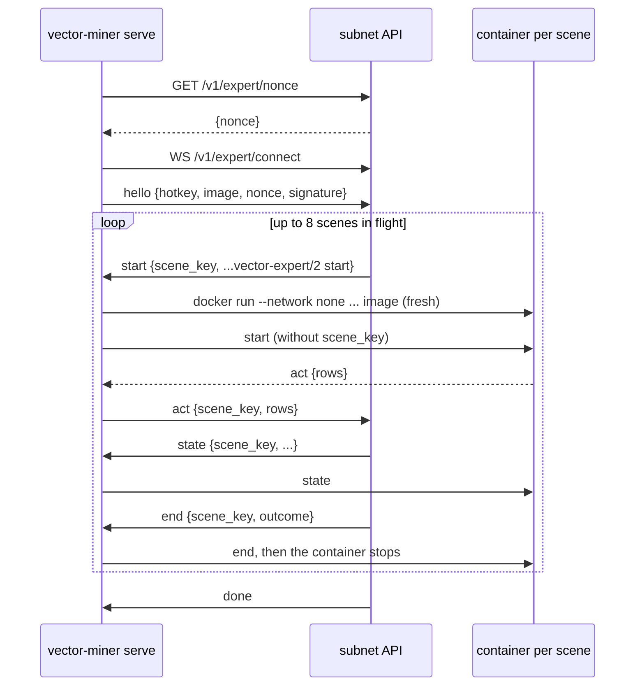
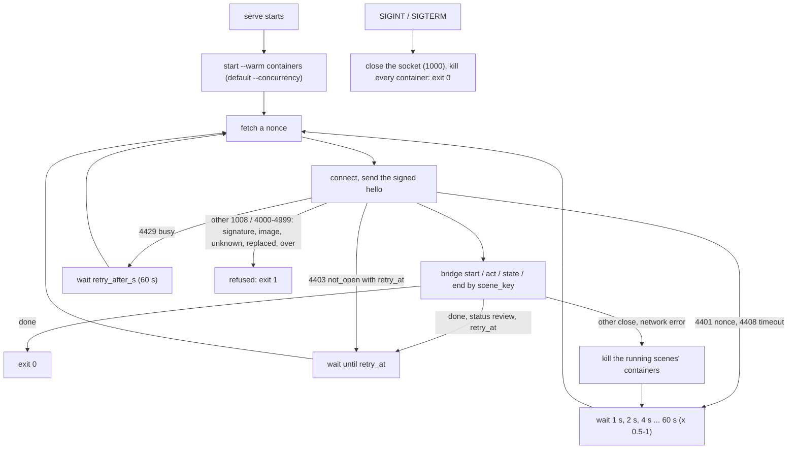
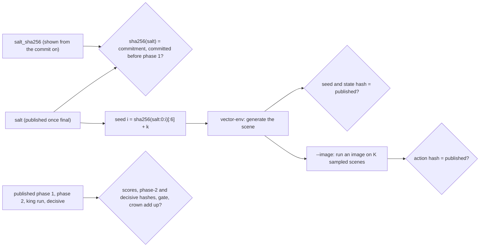

# vector-miner

Miner tools for the Vector subnet's expert competition. You write an expert: a program that picks the target part
out of a bin, step by step, over the `vector-expert/2` protocol (see vector-env). Evaluation is continuous: you
commit one image, once per hotkey, and its evaluation starts as soon as your miner connects.

```mermaid
flowchart LR
  A["write your expert (example/)"] --> B["vector-miner eval: local score"]
  B --> DT["vector-miner eval --determinism N"]
  DT --> C["docker build, push to ghcr.io (public, or private and shared with the team account)"]
  C --> E["image@sha256 digest"]
  R["btcli subnet register: hotkey gets a uid"] --> F
  E --> F["vector-miner commit (once per hotkey, ever)"]
  F --> SV["vector-miner serve: your machine plays 1,000 fresh scenes (phase 1)"]
  SV --> SC["phase-1 score"]
  SC -->|"not above the king's best + margin"| BK["below_king (final)"]
  SC -->|"above"| Q["phase-2 queue, highest score first"]
  Q --> CP["the subnet copies your image into its registry"]
  CP -->|"the image is gone (deleted, or private and not shared)"| DQ["disqualified"]
  CP --> P2["phase 2: the copy runs in docker on 100 of the scenes"]
  P2 -->|"an action hash differs, or a scene is over the wall"| DQ
  P2 -->|"all equal"| KR["king run: the king's image on all 1,000 of your scenes"]
  KR -->|"you > king + 0.02"| DC["decisive re-check: the copy in docker on every scene you won and the king lost"]
  DC -->|"all equal, within the wall"| CR["crowned"]
  DC -->|"an action hash differs, or a scene is over the wall"| DQ
  KR -->|"else"| NC["not_crowned"]
  CR --> V["vector-miner verify --submission ID"]
  NC --> V
  DQ --> V
  BK --> V
```



On commit the subnet makes a secret salt for your submission and publishes its `salt_sha256`; the 1,000 scenes
are drawn from that salt. Phase 1 is played on your machine: `vector-miner serve` dials out to the subnet, our
simulator plays every scene against your image step by step, and each scene's rows are hashed (the action hash).
When your submission reaches the head of the phase-2 queue, the subnet first copies your committed image into its
own registry (until then keep the image public, or private and shared with the subnet's team account with Read
access: an image the subnet cannot pull then is `disqualified`, "image no longer available"); everything after that runs the copy. Phase 2 re-runs it on our side (docker, `--network none`) on 100 of
those scenes: every action hash must equal phase 1's, or the submission is disqualified. Then the king's image plays
all 1,000 of your scenes. When you beat the king by more than the margin (0.02) on those same scenes (an exact
comparison of success counts), the decisive re-check runs your copy again on every scene you won and the king lost
that phase 2 did not already run: every action hash must equal phase 1's and every scene must fit the wall, or the
submission is disqualified. Only then does the crown move, automatically.

## Setup

```bash
git clone https://github.com/robotensor/vector-miner && cd vector-miner
scripts/setup.sh            # clones vector-env and vector-sim next to this folder if missing, .venv, npm ci
```

`setup.sh` clones vector-env at the tag of the version this package pins (`vector-env==0.1.0` in `pyproject.toml`:
`v0.1.0`) and vector-sim at `ARG VECTOR_SIM_REF=` of `example/Dockerfile` (`v0.1.0`), the simulator the example
image and the subnet's harness run. Checkouts already there are kept; one at another commit gets a warning with the
`git checkout` that fixes it. `VECTOR_ENV_REF` and `VECTOR_SIM_REF` override the pins (a tag, a branch or a sha).
`VECTOR_ENV_DIR=<folder>` uses (or clones) vector-env there instead of `../vector-env`. The example's
`@vector/sim` is `file:../../vector-sim/js`, so when vector-sim sits beside that other folder `setup.sh` links it to
`../vector-sim`.

Python 3.12 (`requires-python >=3.12`, `.python-version`), Node 22 or newer (`.nvmrc`: 24), git and docker.
`setup.sh` uses `uv` when it is installed, else `python3 -m venv`, and installs `requirements.lock` (every package
pinned with its hashes, the Bittensor SDK included) with `--require-hashes`. The commands then live in the project's
`.venv`: `.venv/bin/vector-miner`, `.venv/bin/vector-env` and `.venv/bin/btcli` (Bittensor CLI 11), or all three by
name after `source .venv/bin/activate`. Nothing needs a separate `pip install`.

### The asset bundle

Local evaluation needs the asset bundle (robot, crates, part library), pinned by version and sha256 in
vector-env's `vector_env/env.yaml`. Setup finishes without it while no download location is set. The location is
published with the subnet; then:

```bash
VECTOR_ENV_ASSETS_SOURCE=<asset-source> .venv/bin/vector-env assets pull    # downloads and checks the sha256
.venv/bin/vector-env assets info                                           # where the bundle is, its version
```

`VECTOR_ENV_BUNDLE=<folder>` uses a bundle you already have. Where the bundle is looked for, in order:
`VECTOR_ENV_BUNDLE` (or `VECTOR_SIM_BUNDLE`), `<vector-env>/bundle`, then `VECTOR_ENV_CACHE` (default
`~/.cache/vector-env/assets`)`/<version>`; `.venv/bin/vector-env assets dir` prints the folder found.

## From an expert to a submission

```bash
# 1. evaluate locally (a command while developing, then the image)
.venv/bin/vector-miner eval --command "node example/solve.mjs" --scenes 20 --seed 1
cd example && docker build -t ghcr.io/<you>/bin-expert:dev . && cd ..
.venv/bin/vector-miner eval --image ghcr.io/<you>/bin-expert:dev --scenes 100 --seed 7 --workers 4

# 2. check it is deterministic (phase 2 disqualifies an image that is not)
.venv/bin/vector-miner eval --image ghcr.io/<you>/bin-expert:dev --determinism 20 --seed 7 --workers 4

# 3. push to ghcr.io (a GitHub token with write:packages)
echo <github-token> | docker login ghcr.io -u <github-user> --password-stdin
docker push ghcr.io/<you>/bin-expert:dev

# 4. on GitHub: the package's settings -> change visibility -> public, or keep it private and
#    Manage access -> add the team account (`pull_account` in GET <api>/v1/skills/bin-picking/expert), role Read

# 5. the digest
docker inspect --format '{{index .RepoDigests 0}}' ghcr.io/<you>/bin-expert:dev    # ghcr.io/<you>/bin-expert@sha256:<digest>

# 6. a wallet, and its hotkey registered on the subnet (once; read "Wallet and registration" first)
.venv/bin/btcli wallet new-coldkey --wallet <coldkey>
.venv/bin/btcli wallet new-hotkey --wallet <coldkey> --wallet-hotkey <hotkey>
.venv/bin/btcli subnet burn-cost <netuid>
.venv/bin/btcli subnet register --netuid <netuid> --wallet <coldkey> --wallet-hotkey <hotkey>

# 7. optional: a trial commit on testnet (test TAO, never evaluated on mainnet)
.venv/bin/btcli subnet register --network test --netuid <test-netuid> --wallet <coldkey> --wallet-hotkey <hotkey>
.venv/bin/vector-miner commit --network test --netuid <test-netuid> --no-api-check \
  --image ghcr.io/<you>/bin-expert@sha256:<digest> --wallet.name <coldkey> --wallet.hotkey <hotkey>

# 8. commit, once: this hotkey can never commit another image
export VECTOR_MINER_API=https://vector.robotensor.ai
.venv/bin/vector-miner commit --image ghcr.io/<you>/bin-expert@sha256:<digest> --netuid <netuid> \
  --wallet.name <coldkey> --wallet.hotkey <hotkey>

# 9. serve it: phase 1 runs while this runs (start it within 48 h of the commit)
docker pull ghcr.io/<you>/bin-expert@sha256:<digest>
.venv/bin/vector-miner serve --image ghcr.io/<you>/bin-expert@sha256:<digest> \
  --wallet.name <coldkey> --wallet.hotkey <hotkey>

# 10. follow it
.venv/bin/vector-miner status --wallet.name <coldkey> --wallet.hotkey <hotkey>
```

`<netuid>` and `<test-netuid>` are published with the subnet.

### Wallet and registration

- `btcli` 11 (in `.venv`) names the wallet with `--wallet <coldkey>` and `--wallet-hotkey <hotkey>`;
  `vector-miner` takes `--wallet.name <coldkey>`, `--wallet.hotkey <hotkey>` and `--wallet.path`. Both read
  `~/.bittensor/wallets`. The coldkey holds your TAO and pays the registration: keep it encrypted and its recovery
  phrase offline. The hotkey signs your commit and every `serve` connection, and is what gets a uid on the subnet. It commits once:
  one submission per hotkey, ever.
- Registration costs TAO (burned, the price moves with demand: `subnet burn-cost` shows it, the confirmation prompt
  shows it again) or, when the subnet allows it, a proof of work (`subnet register --pow`). It is not refunded.
- A full subnet gives each new registration the uid with the lowest emission among those past their immunity period.
  Only the king earns, so a hotkey without the crown can lose its uid and must register (and pay) again. Check before
  the commit that it has one (`.venv/bin/btcli wallet overview --netuid <netuid> --wallet <coldkey>`): a
  commit from a hotkey without a uid is invalid.
- The testnet trial runs the same checks (without the API check) and sends the same signed call; `{"ok": true, ...}` there means the
  wallet, the reference and the setup work. Testnet registration uses test TAO, which has no value.

## Determinism

The same scene and the same messages must give the same rows, every run, on any machine. Phase 2 checks this on
100 of your scenes by comparing action hashes (vector-env's README defines the hash: FNV-1a 64 over every row value
you sent); one difference disqualifies the submission.

- Seed every random draw from the scene (`scene.scene_id`, `checkpoint`), never from the time, the process id or
  `/dev/urandom`. Python: `random.Random(scene_id)`, numpy: `np.random.default_rng(seed)`; JavaScript has no
  seeded `Math.random`: use a small seeded generator.
- Read no clock to decide anything: no time budgets ("plan until 1.5 s have passed"), no timeouts that change the
  plan. The simulator is paused while it waits for you; phase 2 runs on other hardware than yours.
- No threads or processes racing on a result: a parallel search must merge its results in a fixed order, and
  `--cpus` must not change the answer (phase 2 runs with `--cpus 4 --memory 8g`).
- Floating point: the same image gives the same floats; avoid reductions whose order depends on thread timing
  (multi-threaded BLAS, GPU kernels).
- `vector-miner eval --determinism N` runs N scenes, then runs them again in reverse order, and compares every
  action hash with vector-env's `harness.compare`. Exit 0 = all equal; 1 = a scene sent other rows (listed);
  2 = it could not tell (a scene did not run both times). Run it on the image itself, with `--workers` as high as
  phase 1 will run it.

## Phase 1: serve





- `serve --image REF` takes the image you committed (`ghcr.io/<you>/<repo>@sha256:<digest>`) and runs it as the
  subnet does in phase 2: one fresh container per scene, started by vector-env's own docker command
  (`harness.docker_argv`): `--network none`, read-only root filesystem, `/tmp` in memory, user 65534, no
  capabilities, 256 processes, `--cpus 4 --memory 8g`, the asset bundle at `/bundle` (`VECTOR_SIM_BUNDLE`). The
  image must be local (`--pull` pulls it). `--command "..."` runs a local program per scene instead (development,
  tests); the hello still names `--image`.
- The hello is signed by the wallet's hotkey: sr25519 over `vector-connect\n<image>\n<nonce>`, with a nonce fetched
  fresh for every connection. The subnet only plays scenes for the hotkey and image of a commit.
- Your expert sees exactly the `vector-expert/2` lines of a local `eval` (the `scene_key` is removed); what it
  writes goes back with its `scene_key`. A line that is not a JSON object, a line over 1 MiB, or an exit before the
  scene's `end` is sent to the subnet as `{"type":"error"}` for that scene.
- Deadlines (the simulator is paused while it waits for you):

  | wait | limit | welcome field |
  |---|---|---|
  | the first `act`, after `start` | 10 s | `first_step_deadline_s` |
  | every later `act`, after a `state` | 2 s | `step_deadline_s` |
  | the whole scene | 45 s | `wall_s` |

  A late act ends the scene as `step_timeout`, a scene over its wall time as `wall_timeout`; both, and a dropped
  connection, are your failures, and phase 2 leaves those scenes out of its sample. `vector-miner eval` holds your
  expert to the same deadlines. Containers are started ahead (`--warm N`, default `--concurrency`) so a scene does
  not wait for `docker run`; `--concurrency N` (default 8, what the subnet sends at once) is the most scenes `serve`
  runs at once: a `start` past it is answered with an error (that scene is your `expert_error`) and the welcome's
  `concurrency` above yours is logged as a warning, so keep it at 8. A `start` for a restart of a scene
  (`<index>.<n>`) replaces the older one. Messages from the subnet are at most 4 MiB.
- The subnet checks every act: a message is at most 64 KiB (300 rows of 7 numbers fit), at most 200 messages a second
  are read per socket (faster ones wait), and a row must be 7 finite numbers within ±100. `NaN`, `Infinity`, a string,
  `true` or a larger value ends that scene as `expert_error`, your failure.
- When the connection drops, the running scenes' containers are killed and `serve` reconnects with backoff
  (1 s doubling to 60 s, times 0.5 to 1); the subnet restarts the unfinished scenes from tick 0, at most twice per
  scene. Keep `serve` running until it prints `done`.
- `{"type":"welcome"}` (submission, status, `done`/`scenes`, the deadlines) and `{"type":"error"}` without a
  `scene_key` (its `reason` and `message`) are printed. `{"type":"done"}` (phase 1 finished: status, score,
  successes/scenes) ends `serve` with exit 0; when its status is `review` with a `retry_at` (scenes failed on the
  subnet's side), `serve` waits until then and connects again.
- A refusal is a `{"type":"error", reason, message}` and a close whose reason is `<reason>: <message>`. Not final,
  `serve` connects again: `4429 busy` after `retry_after_s` (default 60 s); `4403 not_open` with a `retry_at`
  (phase 1 in review) at that time; `4408 timeout` and `4401` for an unknown or expired nonce with the usual backoff
  (a nonce refusal at most 5 times in a row). Final, exit 1 with the reason: a bad signature or hello (`4401`), not
  the committed image (`4403 image`), no submission for the hotkey (`4404`), phase 1 over (`4403 not_open` without
  `retry_at`), a newer connection of the same submission (`4409 replaced`), a message too big (`4413`), and any
  other 1008 or 4000-4999 close.
- Ctrl-C or SIGTERM closes the socket (code 1000) and kills every container: exit 0. `--stderr DIR` keeps each
  container's stderr in `DIR/<container name>.log`; the log names the scene of each container.

## Status

```bash
.venv/bin/vector-miner status --api https://vector.robotensor.ai --wallet.name <coldkey> --wallet.hotkey <hotkey>
```

One JSON object: `king` (whether you are the king), `king_hotkey`, `king_image` (null for the genesis king, which
runs as a command: `king_note` then says `king: no image published`), `king_best`, `margin`, and `submissions`, each
with `id`, `image`, `status`, `committed_at`, `salt_sha256`, `phase1 {done, total, score, successes}`,
`queue_position` (phase-2 queue, highest phase-1 score first), `phase2`, `king_same_scenes {hotkey, image, done,
total, score}` (the king's run on your scenes), `reason`, `retry_at`, `final` and `verdict` (one line, also printed
to stderr).
It reads `GET /v1/skills/bin-picking/expert` and `GET /v1/skills/bin-picking/expert/submissions?hotkey=<ss58>`.

| status | meaning |
|---|---|
| `waiting_connection` | committed; run `serve` (abandoned after 48 h without any connection attempt; a refusal because every slot is busy counts as an attempt) |
| `phase1` | `serve` is playing your scenes: `phase1.done` of `phase1.total`. After the first hour on the socket it must keep up 200 scenes an hour on average (8 at once do ≥ 640), or the rest count as failures and the slot goes to the next miner |
| `scored` | phase 1 is done and above the king's best + margin: in the phase-2 queue (`queue_position`) |
| `below_king` | phase 1 is not above the king's best + margin; final. A queued submission is re-checked after every crowning |
| `phase2` | `stage` `copy`: we copy your image into our registry; then we run the copy in docker on 100 of your scenes and compare action hashes |
| `king_run` | phase 2 passed; the king's image plays all your scenes; `stage` `decisive`: the decisive re-check (`decisive {done, total}`) |
| `crowned` / `not_crowned` | your phase-1 score against the king's on the same scenes, with the margin; final |
| `disqualified` | phase 2 or the decisive re-check found another action hash or a scene over the wall, the image was gone when we copied it, or a stage failed on our side again after 2 reviews (`reason`); final |
| `duplicate_hotkey` | a second commit from a hotkey that already had one; never evaluated |
| `invalid` / `copy` | a bad commit, the digest of an earlier submission; neither uses the hotkey's submission, so it may commit again |
| `abandoned` | no connection attempt within 48 h; final, and it does not use the hotkey's submission: the hotkey may commit again |
| `review` | more than 2 % of a stage's scenes failed on the subnet's side; that stage runs again at `retry_at` (6 h later). Not your expert's fault; in phase 1 keep `serve` running |

## Commands

```bash
vector-miner eval (--command "..." | --image REF) [--scenes 20 | --determinism N] [--seed 0] [--workers 1]
                  [--time-limit 15] [--wall 45] [--cpus 4] [--memory 8g] [--docker docker] [--pull] [--results FILE]
                  [--stderr DIR] [--trace DIR] [--scene-cache DIR | --no-scene-cache]
                  [--first-step-deadline 10] [--step-deadline 2] [--strict] [--determinism N]
vector-miner commit --image REF --netuid <netuid> [--network finney] [--api URL | --no-api-check]
                    [--wallet.name --wallet.hotkey --wallet.path] [--no-check]
vector-miner serve --image REF [--api URL] [--concurrency 8] [--warm N] [--command "..."] [--cpus 4] [--memory 8g]
                   [--docker docker] [--pull] [--stderr DIR] [--wallet.name --wallet.hotkey --wallet.path]
vector-miner status [--api URL] [--hotkey <ss58>] [--wallet.name --wallet.hotkey]
vector-miner verify --submission ID (--api URL | --doc FILE) [--save FILE] [--hash-scenes M]
                    [--image REF|submission|king [--command "..."] [--scenes 20] [--sample-seed 0] [--workers 1]
                    [--wall S] [--cpus 4] [--memory 8g] [--docker docker] [--pull]] [--salt-sha256 HEX]
                    [--allow-uncommitted]
```

`$VECTOR_MINER_API` can hold the API address (`--api`).

- `eval` generates random scenes from `--seed` and plays them the way phase 1 does: vector-env's remote harness
  sends the messages through `serve`'s bridge (in-process, no network) to a fresh expert per scene, started ahead
  like `serve --warm`, and holds every act to the phase-1 deadlines: 10 s for the first act after `start`
  (`--first-step-deadline`), 2 s for each later one (`--step-deadline`). A late act ends the scene `step_timeout`,
  as in phase 1. The summary gains `deadlines` (`first_act_max_s`, `first_act_mean_s`, `later_act_max_s`, measured
  at the bridge; `late_scenes`, `step_timeouts`), a warning lists late acts, and `--strict` makes them exit 1.
  `--workers N` scenes run at once on this machine, which also runs the simulator: phase 1 runs 8 and the
  simulator is on the subnet's side, so measure with `--workers 8` on the machine that will `serve`.
  `--command` runs a local program (no docker, no sandbox). `--image` starts a fresh container per scene as
  phase 2 does: `--network none`, read-only root filesystem, `/tmp` in memory (1 GB), user 65534 with `HOME=/tmp`,
  no capabilities, 256 processes, 1024 open files, `--cpus 4 --memory 8g`, 15 s of robot time and 45 s of wall
  time per scene. The image must already be local (`--pull` pulls it first). `--results` writes one JSON line per
  scene (both runs with `--determinism`); `--stderr DIR` writes your expert's stderr of every scene to
  `DIR/<index, 4 digits>-<scene_id>.log` (e.g. `0000-s121011998878783-4a5b69a2.log`); `--trace DIR` writes a
  per-tick trace of every scene (below). Change the limits only to experiment: the subnet uses the defaults.
  Without an asset bundle (see vector-env) `eval` prints the reason and exits 2.
- Generating a scene takes about 2 s. `--workers N` generates (and runs) N scenes at a time, and generated scenes
  are kept in `~/.cache/vector-env/scenes` (per vector-env version, asset sha256, draw, seed and index), so the
  next `eval` with the same `--seed` reuses them: compare variants of your expert on the same seed.
  `--scene-cache DIR` (or `VECTOR_ENV_SCENE_CACHE`) moves the cache, `--no-scene-cache` turns it off.
- `commit` applies the subnet's checks before it sends anything: the reference is
  `<registry>/<repo>@sha256:<64 hex>` (lower case, no tag), at most 128 characters, and the registry is `ghcr.io`.
  It then asks the registry anonymously for that digest: an unknown digest or a registry that answers another digest
  is refused (`--no-check` skips this). A private image (anonymous pulls refused) that your own docker login can
  read (`docker manifest inspect`) is committed with a warning: the subnet pulls images as its team account
  (`pull_account` of `GET /v1/skills/bin-picking/expert`, named in the warning), so share the package with that
  account (ghcr.io: Package settings -> Manage access -> add it, role Read) before you commit, or the commit is
  `invalid`. The reference is committed without
  surrounding spaces.
- One submission per hotkey, ever. `commit` asks the public API
  (`GET /v1/skills/bin-picking/expert/submissions?hotkey=<ss58>`) first and refuses when the hotkey's submission is
  used: any earlier commit except an `invalid`, `copy`, `duplicate_hotkey` or `abandoned` one, which the subnet does
  not count.
  The subnet would record a second commit as `duplicate_hotkey` and never evaluate it. To submit another image, register another hotkey. When the API cannot be reached `commit` stops;
  `--no-api-check` skips the check (the testnet trial). The same digest, or the same image layers under another
  digest, as an earlier submission of another hotkey is a `copy`.
- After a commit, `commit` prints the `serve` command to start; phase 1 waits for it at most 48 h.

### Inspect a failure

```bash
.venv/bin/vector-miner eval --command "node example/solve.mjs" --scenes 30 --seed 1 --workers 4 \
  --results r.jsonl --trace traces --stderr logs
#   why s27260578352828-f7734b96: timed_out at tick 300 (15 s): 15 s | ... | the target was held for 18 ticks
#   (ticks 52-69); it was not held from tick 70 | its lowest point got to 202.3 mm below the lift line ...
.venv/bin/vector-env scene --seed 27260578352828 > scene.json
.venv/bin/vector-env replay --scene scene.json --result r.jsonl --trace one.json
```

Each failed scene gets a `why` line. `traces/<index>-<scene_id>.json` holds, per tick, the row stepped, the joints,
the grip, the tcp pose, the parts held and touched and the target's height against the lift line, plus `reasons`
and a `summary`; vector-env's README lists every field. The scene's seed is the number after `s` in its id.

## Verify a submission

Once a submission is final (`below_king`, `crowned`, `not_crowned` or `disqualified`), the API publishes everything
needed to check it at `GET /v1/skills/bin-picking/expert/submissions/<id>/verify` (404 until then): the salt and
its commitment, the vector-env version and asset sha256 the scenes were made with, every scene's seed and state
hash, phase 1 (score and per-scene success, time, outcome, action hash), phase 2 (the scenes, their action hashes
and wall times), the king's run on the same scenes, the decisive re-check (its scenes, action hashes and wall times)
and the decision; `submission.mirror_url` is the subnet's copy of the image.



```bash
# check the document and regenerate all 1000 scenes (about 2 s each; --hash-scenes 100 checks a sample)
.venv/bin/vector-miner verify --submission <id> --api https://vector.robotensor.ai

# also re-run the submission's image on 20 sampled scenes in docker and compare action hashes
.venv/bin/vector-miner verify --submission <id> --api https://vector.robotensor.ai --hash-scenes 100 \
  --image submission --scenes 20 --pull

# the king's image on the same scenes; the salt commitment you noted at commit time
.venv/bin/vector-miner verify --submission <id> --api https://vector.robotensor.ai --image king --scenes 10 \
  --salt-sha256 <64 hex>
```

- Seeds: scene `i` uses `int.from_bytes(sha256(f"{salt}:0:{i}").digest()[:6], "big")`, vector-env's
  `scenes.seed_for(0, i, salt)`, plus `k`: the first `k` below `seed_tries` (6) whose draw places a scene
  (`scenes.draw_scene`). An index none of whose draws places a scene is listed in `skipped`; a full check also
  confirms every skipped index fails here.
- The salt: `salt_sha256` must be the sha256 of the published salt, committed (`salt_committed_at`) no later than
  `phase1_started_at`, and equal to `--salt-sha256` when given, else to the submission view's `salt_sha256`
  (`GET /v1/skills/bin-picking/expert/submissions/<id>`) when the document comes from `--api`. A null
  `salt_committed_at` (or `phase1_started_at`) is a document problem (exit 1); `--allow-uncommitted` lists it under
  `document.warnings` instead and checks the rest.
- The document check: the seeds derive from the salt, `scenes_sha256` is
  `sha256("\n".join(f"{index}:{seed}:{state_hash}"))`, the phase-1 score is successes / scenes with a verdict
  (infrastructure failures, an `INFRA_OUTCOMES` outcome or none, are left out; `not_run` and timeouts count as
  failures), mean times match the successful scenes; `below_king` needs a phase-1 score not above
  `decision.king_best` + `margin` and no phase 2; any other final status needs one above it and a phase 2 on the
  sample rule's scenes: the `phase2_scenes` (100) indexes with the smallest `sha256(f"{salt}:phase2:{index}")`,
  sorted, among the phase-1 scenes with an action hash and an outcome not in `excluded_outcomes` (the
  infrastructure outcomes, `not_run` and the cut-offs `step_timeout`, `disconnected`, `wall_timeout`; a document
  that leaves out any other outcome is a problem; one without the field is read with the older rule, only
  infrastructure failures and `not_run` left out). Each phase-2 scene has an outcome, an action hash and a wall
  time; phase-2 infrastructure failures are left out of the
  comparison, and it passes when at least one scene is compared, every hash equals phase 1's and no scene is a
  `wall_timeout` or over `wall_s`; `disqualified` needs a phase 2 that did not pass and a reason, or a failed
  decisive re-check after a passed phase 2 and a king run it beat, or a reason that starts with `image no longer
  available` / `repeated failures on our side` (then nothing after phase 1 is needed); `crowned` and `not_crowned`
  need phase 2 passed and a king run, whose score and `decision.score` are successes on the scenes where both runs
  gave a verdict, and `crowned` exactly when (successes − king successes) / compared is above `margin` (exact
  fractions; the gate is compared the same way). The decisive scenes are recomputed: both runs gave a verdict, the
  submission succeeded and the king did not, not in `phase2.scenes`; `crowned` needs a `decisive` section on exactly
  those scenes with phase 1's action hashes, none over `wall_s`; `not_crowned` has none.
  Images must be `ghcr.io/<repo>@sha256:<digest>` with their own `digest`; the genesis king (no `id`) runs as a
  command and has no image: a warning `king: no image published`, and `--image king` skips the re-run.
- `--image` takes `submission`, `king`, or that image's reference, digest or hotkey; it runs the image (or
  `--command` instead) on `--scenes` scenes with a published verdict that is not a cut-off, sampled with `--sample-seed`, and reports
  `hash_equal`, `hash_agreement`, `outcome_agreement` and every scene whose action hash differs. A deterministic
  image gives the published hashes on any machine. Re-run differences do not change the exit code.
- `phase2` in the output repeats the phase-2 comparison: `compared`, `equal`, `mismatched`, `over_wall`, `infra`,
  `passed`; `decisive` the decisive re-check: `scenes`, `equal`, `mismatched`, `over_wall`, `infra`, `expected` (the
  recomputed decisive scenes), `passed`; `same_scenes` repeats the decision: `compared`, `score`, `king_score`.
- The document is read as strict JSON (no NaN), at most 64 MB, and every field is type-checked first.
- Regeneration needs the same vector-env version and asset bundle as the submission (`env` in the document, or a
  scene's own `env` when it was made with another one); with another one, the output warns, and a scene whose
  hash differs is listed under `unverified` (not as a mismatch). When the generator fails on every scene, including
  a known published one (no node, a missing or broken asset bundle), the check stops with exit 2.
- `--save FILE` keeps the document; `--doc FILE` checks a saved one offline. The output is one JSON object.
  Exit codes: 0 = the document adds up and every regenerated scene matches; 1 = a document problem (no salt
  commitment time included, unless `--allow-uncommitted`) or a scene mismatch (listed in the output); 2 = cannot
  check: a bad argument (no `--submission`, `--command` without `--image`, no `--api` without `--doc`, a `--doc`
  that is unreadable or of another submission, `--workers` below 1, a malformed `--salt-sha256`), a malformed,
  non-JSON or oversized document, the submission is not final (404) or the API failed, an image that did not run
  for the submission, vector-env is missing or its generator does not work here, the pull failed or the re-run
  could not run (docker missing, every scene an infra outcome), or scenes are `unverified` (the output is printed).
  Re-run differences are reported under `rerun` and do not change the exit code.

The example image (`example/Dockerfile`) runs as user 65534 with `HOME=/tmp` and writes nothing outside `/tmp`.
Files your image reads must be readable by that user.

## Tests

```bash
.venv/bin/python -m pytest
```

The `serve` tests run a fake subnet (a `websockets` server with the nonce endpoint) and `tests/fake_expert.py`;
with an asset bundle they also play real scenes through vector-env's remote harness and compare the action hashes
with a local run. No test talks to a chain.

## License

Apache-2.0.
