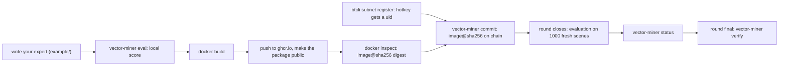
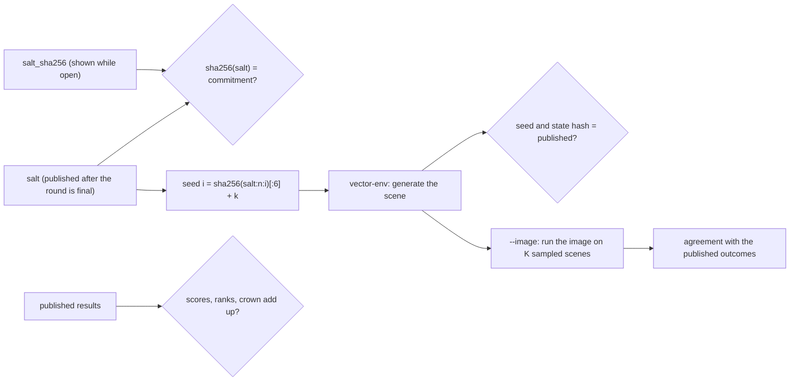

# vector-miner

Miner tools for the Vector subnet's expert competition. You write an expert: a program that picks the target part
out of a bin, step by step, over the `vector-expert/2` protocol (see vector-env). The team runs every
committed image on 1000 fresh scenes after the weekly round closes.



## Setup

```bash
git clone https://github.com/robotensor/vector-miner && cd vector-miner
scripts/setup.sh            # clones vector-env and vector-sim next to this folder if missing, .venv, npm ci
```

`VECTOR_ENV_DIR=<folder>` uses (or clones) vector-env there instead of `../vector-env`. The example's
`@vector/sim` is `file:../../vector-sim/js`, so when vector-sim sits beside that other folder `setup.sh` links it to
`../vector-sim`.

Python 3.12 (`requires-python >=3.12`, `.python-version`), Node 22 or newer (`.nvmrc`: 24), git and docker.
`setup.sh` uses `uv` when it is installed, else `python3 -m venv`, and installs `requirements.lock` (every package
pinned with its hashes, the Bittensor SDK included) with `--require-hashes`.

### The asset bundle

Local evaluation needs the asset bundle (robot, crates, part library), pinned by version and sha256 in
vector-env's `vector_env/env.yaml`. Setup finishes without it while no download location is set. The location is
published with the subnet; then:

```bash
VECTOR_ENV_ASSETS_SOURCE=<asset-source> .venv/bin/vector-env assets pull    # downloads and checks the sha256
.venv/bin/vector-env assets info                                           # where the bundle is, its version
```

`VECTOR_ENV_BUNDLE=<folder>` uses a bundle you already have. Where the bundle is looked for, in order:
`VECTOR_ENV_BUNDLE` (or `VECTOR_SIM_BUNDLE`), `<vector-env>/bundle`, then `VECTOR_ENV_CACHE` (default
`~/.cache/vector-env/assets`)`/<version>`; `.venv/bin/vector-env assets dir` prints the folder found.

## From an expert to a submission

```bash
# 1. evaluate locally (a command while developing, then the image)
.venv/bin/vector-miner eval --command "node example/solve.mjs" --scenes 20 --seed 1
cd example && docker build -t ghcr.io/<you>/bin-expert:dev . && cd ..
.venv/bin/vector-miner eval --image ghcr.io/<you>/bin-expert:dev --scenes 100 --seed 7 --workers 4

# 2. push to ghcr.io (a GitHub token with write:packages)
echo <github-token> | docker login ghcr.io -u <github-user> --password-stdin
docker push ghcr.io/<you>/bin-expert:dev

# 3. on GitHub: the package's settings -> change visibility -> public

# 4. the digest
docker inspect --format '{{index .RepoDigests 0}}' ghcr.io/<you>/bin-expert:dev    # ghcr.io/<you>/bin-expert@sha256:<digest>

# 5. register your hotkey on the subnet (once; a commit from a hotkey without a uid is invalid)
btcli subnet register --netuid <netuid> --wallet.name <coldkey> --wallet.hotkey <hotkey>

# 6. commit, while a round is open
.venv/bin/vector-miner commit --image ghcr.io/<you>/bin-expert@sha256:<digest> --netuid <netuid> \
  --wallet.name <coldkey> --wallet.hotkey <hotkey>

# 7. follow it
.venv/bin/vector-miner status --api https://vector.robotensor.ai --wallet.name <coldkey> --wallet.hotkey <hotkey>
```

`<netuid>` is published with the subnet. `btcli` comes with the Bittensor CLI (`pip install bittensor-cli`), not
with this package.

## Commands

```bash
vector-miner eval (--command "..." | --image REF) [--scenes 20] [--seed 0] [--workers 1] [--time-limit 15] [--wall 45]
                  [--cpus 4] [--memory 8g] [--docker docker] [--pull] [--results FILE]
vector-miner commit --image REF --netuid <netuid> [--network finney] [--wallet.name --wallet.hotkey --wallet.path] [--no-check]
vector-miner status --api https://vector.robotensor.ai [--hotkey <ss58>] [--rounds 3] [--wallet.name --wallet.hotkey]
vector-miner verify --round N (--api https://vector.robotensor.ai | --doc FILE) [--save FILE] [--hash-scenes M]
                    [--image REF [--command "..."] [--scenes 20] [--sample-seed 0] [--workers 1] [--wall S]
                    [--cpus 4] [--memory 8g] [--docker docker] [--pull]]
```

- `eval` generates random scenes from `--seed` and runs your expert through the same harness the subnet uses.
  `--command` runs a local program (no docker, no sandbox). `--image` starts a fresh container per scene as the
  round does: `--network none`, read-only root filesystem, `/tmp` in memory (1 GB), user 65534 with `HOME=/tmp`,
  no capabilities, 256 processes, 1024 open files, `--cpus 4 --memory 8g`, 15 s of robot time and 45 s of wall
  time per scene. The image must already be local (`--pull` pulls it first). `--results` writes one JSON line per
  scene. Change the limits only to experiment: the round uses the defaults. Without an asset bundle (see
  vector-env) `eval` prints the reason and exits 2.
- `commit` applies the subnet's checks before it sends anything: the reference is
  `<registry>/<repo>@sha256:<64 hex>` (lower case, no tag), at most 128 characters, and the registry is `ghcr.io`.
  It then asks the registry anonymously for that digest, as the subnet does: a private image, an unknown digest or
  a registry that answers another digest is refused (`--no-check` skips this). The reference is committed without
  surrounding spaces.
- `status` prints your submissions of the last `--rounds` rounds, their scores and the king. `$VECTOR_MINER_API`
  can hold the API address.
- The image must be public on `ghcr.io` and pinned by digest; one submission per hotkey per round (the latest
  commit before the close). The same digest as an earlier submission is a copy. An invalid commit is not retried:
  fix the cause and commit again.

## Verify a round

Nobody sees a round's scenes before the evaluation: they come from a salt drawn while the round is open and kept
secret; its `salt_sha256` is shown on the board and in the round view from then on, so the salt cannot be changed
later to pick favourable scenes. Once the round is final (evaluated, and the crown kept or moved), the API publishes everything needed to check it at
`GET /v1/skills/bin-picking/expert/rounds/<n>/verify` (404 until then): the salt and its commitment, the vector-env version and asset
sha256 the scenes were made with, every scene's seed and state hash, and every evaluated image (the king's re-run
and each challenger, by digest) with its score, rank and per-scene outcome and time.



```bash
# check the document and regenerate all 1000 scenes (about 2 s each; --hash-scenes 100 checks a sample)
.venv/bin/vector-miner verify --round 12 --api https://vector.robotensor.ai

# also re-run the winner on 20 sampled scenes in docker and compare outcomes
.venv/bin/vector-miner verify --round 12 --api https://vector.robotensor.ai --hash-scenes 100 \
  --image ghcr.io/<them>/bin-expert@sha256:<digest> --scenes 20 --pull

# also compare the salt with the commitment you noted from the board while the round was open
.venv/bin/vector-miner verify --round 12 --api https://vector.robotensor.ai --salt-sha256 <64 hex>

# your own program in place of an image (no docker)
.venv/bin/vector-miner verify --round 12 --api https://vector.robotensor.ai --image <digest> \
  --command "node example/solve.mjs" --scenes 5
```

- Seeds: scene `i` of round `n` uses `int.from_bytes(sha256(f"{salt}:{n}:{i}").digest()[:6], "big")`, which is
  vector-env's `scenes.seed_for(n, i, salt)`, plus `k`: the first `k` below `seed_tries` (6) whose draw places a
  scene. An index none of whose draws places a scene is listed in `skipped`; a full check (no `--hash-scenes`)
  also confirms every skipped index fails here. `draw`, `task` and `wall_s` are the round's own settings.
- The salt: `salt_sha256` must be the sha256 of the published salt, committed (`salt_committed_at`) no later than
  the close (`closed_at`), and equal to `--salt-sha256` when given, else to the round view's `salt_sha256` when
  the document comes from `--api`.
- The document check: the seeds derive from the salt, `scenes_sha256` is
  `sha256("\n".join(f"{index}:{seed}:{state_hash}"))`, every score is successes / scenes, mean times match the
  successful scenes, ranks follow score, then mean time, then commit block, and a crown only went to a challenger
  that beat the king's re-run by more than the margin; a decision that names a king needs that king's image, and
  the winner is the best-ranked challenger that is not `infra_failed`. Each evaluated `run_image` must be
  `ghcr.io/<repo>@sha256:<digest>` with the image's own `digest`; otherwise it is a document problem and `--image`
  does not run (or pull) it.
- Images that did not finish are listed under `unfinished`: status `stopped` or `infra_failed`, `stop_reason`,
  how many scenes are `not_run`, `infra_failures`. A re-run skips the image's `not_run` scenes.
- An image without a published `run_image` is listed under `not_rerunnable`; the genesis king (the team's expert,
  run as a command, `team: true`) shows as "team expert (not publicly re-runnable)". Its scenes, scores and the
  decision are still checked; `--image` on it needs `--command`.
- The document is read as strict JSON (no NaN), at most 64 MB, and every field is type-checked first.
- Regeneration needs the same vector-env version and asset bundle as the round (`env` in the document, or a
  scene's own `env` when it was made with another one); with another one, the output warns, and a scene whose
  hash differs is listed under `unverified` (not as a mismatch). When the generator fails on every scene, including
  a known published one (no node, a missing or broken asset bundle), the check stops with exit 2.
- `--image` takes an evaluated image's reference, digest or hotkey. It runs that image's published `run_image` (the
  reference the round ran) on `--scenes` scenes sampled with `--sample-seed`, or `--command` instead, and reports
  `agreement` (same success), `outcome_agreement`, the time difference and every disagreeing scene. A different
  machine can change a few borderline outcomes; the published results are what the round decided on.
  `--wall` defaults to the round's `wall_s` (else vector-env's `harness.wall_s`).
- `--save FILE` keeps the document; `--doc FILE` checks a saved one offline. The output is one JSON object.
  Exit codes: 0 = the document adds up and every regenerated scene matches; 1 = a document problem or a scene
  mismatch (listed in the output); 2 = cannot check: a bad argument (`--command` without `--image`, no `--api`
  without `--doc`, a `--doc` that is unreadable or of another round, `--workers` below 1, a malformed
  `--salt-sha256`), a malformed, non-JSON or oversized document, the round is not final (404) or the API failed,
  the image was not evaluated in the round, vector-env is missing or its generator does not work here, the pull
  failed or the re-run could not run (docker missing, every scene an infra outcome), or scenes are `unverified`
  (the output is printed). Re-run disagreements are reported under `rerun` and do not change the exit code.

The example image (`example/Dockerfile`) runs as user 65534 with `HOME=/tmp` and writes nothing outside `/tmp`.
Files your image reads must be readable by that user.

## Tests

```bash
.venv/bin/python -m pytest
```

## License

Apache-2.0.
