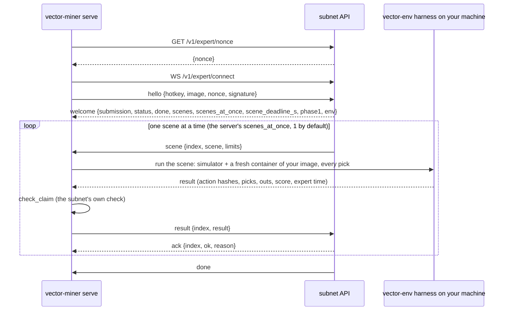
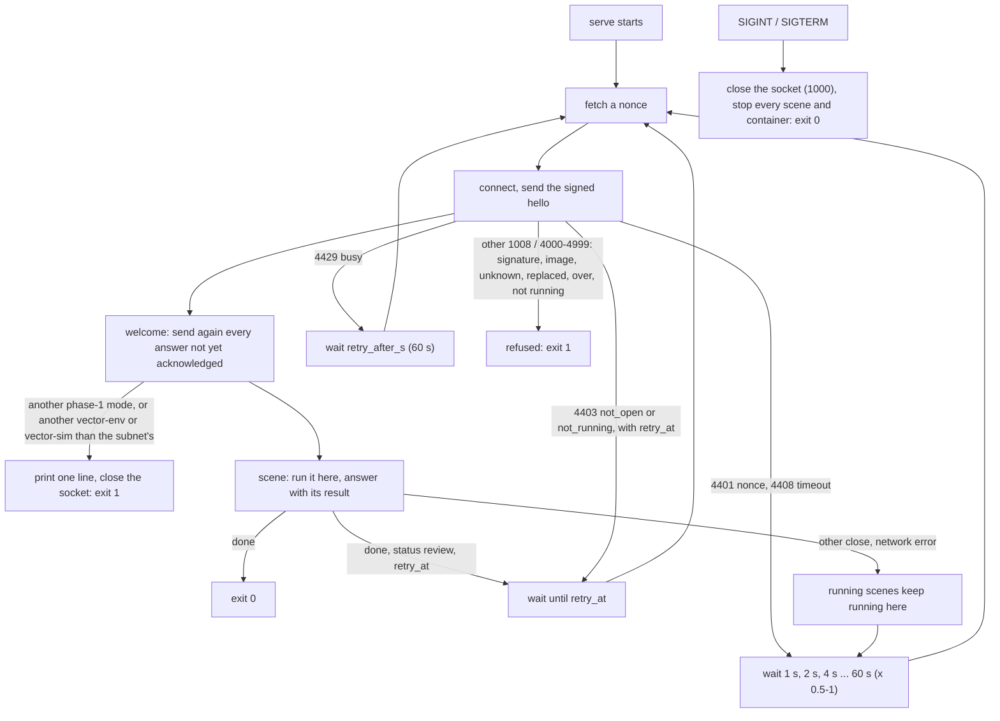
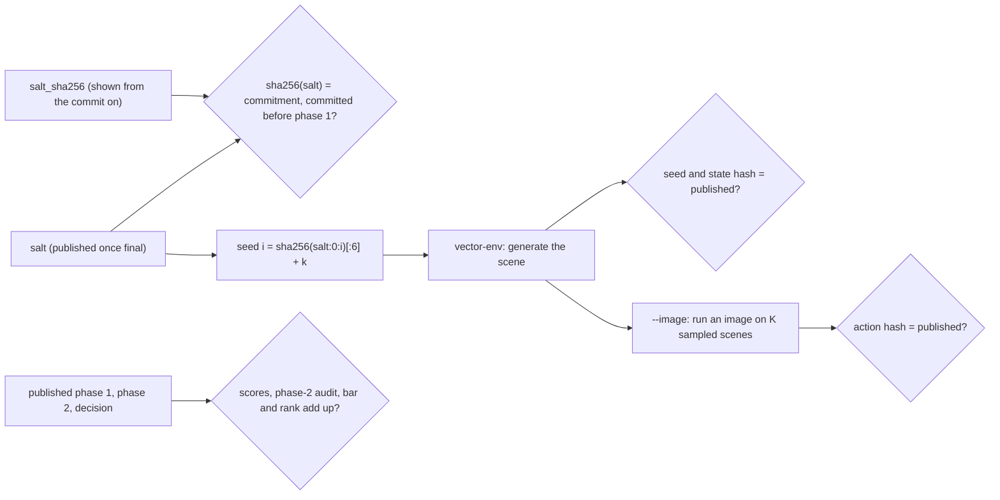

# bin-picking-expert

The miner guide of the competition `bin-picking-expert`. You write an expert: a program that picks target parts
out of a pile in a bin, step by step, over the `vector-expert/3` protocol ([vector-env](https://github.com/robotensor/vector-env/blob/main/skills/bin-picking/README.md#vector-expert2-and-3)). You commit one image, once per
hotkey; phase 1 starts as soon as your miner connects, and the rest of the evaluation runs after the end of the round
in which phase 1 ended. Setup, the wallet and the `vector-miner` command are in the repository's
[README](../../../README.md). Every command below runs from the vector-miner folder.

```mermaid
flowchart LR
  A["write your expert (skills/bin-picking/expert/example/)"] --> B["vector-miner eval: local score"]
  B --> DT["vector-miner eval --determinism N"]
  DT --> C["docker build, push to ghcr.io (public, or private and shared with the team account)"]
  C --> E["image@sha256 digest"]
  R["btcli subnet register: hotkey gets a uid"] --> F
  E --> F["vector-miner fee pay, then vector-miner commit (once per hotkey, ever)"]
  F --> SV["vector-miner serve: your machine runs your scenes one by one (simulator + your image), 100 by default (phase 1)"]
  SV --> SC["phase-1 score"]
  SC -->|"not above the bar (the king's score + margin)"| BK["below_king (final)"]
  SC -->|"above"| RE["the subnet copies your image into its private registry, and the submission waits for the end of its round (the round its phase 1 ended in)"]
  RE --> Q["the round's evaluation: highest phase-1 score first, one at a time"]
  Q --> CP["the subnet copies your image into its private registry, if that has not happened yet"]
  CP -->|"the image is gone (deleted, or private and not shared)"| DQ["disqualified"]
  CP --> P2["phase 2: the copy re-runs in docker on a random sample of your phase-1 scenes and on every scene that ended in a cut-off, and on the private evaluation when the round has one"]
  P2 -->|"a pick's expert time is over the wall"| DQ
  P2 -->|"audited: a claimed pick the re-run did not repeat scores -1"| PS["passed: final score; waits for the round decision"]
  PS --> RD{"round decision: the round's best three final scores above the bar"}
  RD -->|"in"| RK["ranked: rank 1 (the king) 70 %, rank 2 20 %, rank 3 10 % of bin-picking-expert's emission"]
  RD -->|"out"| NR["not_ranked"]
  RK --> KP["rank 1: its image is published at ghcr.io/robotensor/vector-king"]
  RK --> V["vector-miner verify --submission ID"]
  NR --> V
  DQ --> V
  BK --> V
```



## The task and the score

A scene is a bin filled to between half and two thirds of its depth with a random pile of 50 to 150 parts of 1 to
8 kinds. A scene is 10 picks in a row from the same bin; the robot goes on from where it is after each pick. For each
pick the subnet names one target part: lift it out and hold it above the lift line, alone, for the hold time. Each
pick has 15 s of robot time. Targets are not only the free ones on top: a target can be blocked (other parts lie on
it or press against it), partly buried, or hidden: not visible to the camera, covered by one or two layers of parts.
Only one part may be picked at a time: the moment two or more parts are above the lift line at the same tick, the
pick ends as a failure (`multi_pick`, pick score 0). You may move other parts inside the bin (push them, lift them
one at a time and put them down); lifting one part that is not the target is not a failure, and a dropped target
can be tried again until the pick's time runs out. The next pick's target is
named when a pick ends, never a part a pick of this scene already failed on; when no target is left the scene ends
early and its remaining picks score 0. Scenes may also come from other assets in the same format (phase 2).

**Nothing may leave the bin.** A part that ends up outside the bin is an *out*. Outs do not end a pick; they are
counted over the whole scene and cost exponentially more the more there are.

```
pick i:      s_i * (1 - 0.5 * min(1, t_i / 15 s))          s_i = 1 if pick i succeeded, else 0; t_i = its robot time
scene score: (sum of the 10 pick scores - (2^K - 1)) / 10   K = the parts out of the bin in the whole scene
```

1.0 is ten instant picks; one part out costs as much as one lost pick, 2 outs cost 3 picks, 10 outs cost 1,023, so a
scene score can be far below 0. The phase-1 score is the mean scene score over all your scenes: a scene your machine
could not run (an infrastructure outcome), a refused answer and a scene not answered in time each score 0. The
formula of a round is fixed when its scenes are drawn and published in each submission's verify document
(`score_formula`; it also has a path-length weight, 0 now). A scene whose simulation diverges ends `physics_error`:
that pick scores 0, the earlier picks count, and the scene counts. A scene cut off on your side (`wall_timeout`,
`step_timeout`, `disconnected`) is scored by its picks so far. After phase 2 the audited scenes score what phase 2
found (see Phase 2).

## Rounds

bin-picking-expert runs in rounds of its own. Their length is a setting of this competition; the rounds are shown
with their dates in `GET /v1/skills/bin-picking/expert`: the current one as `round`, the next one as `next`, both in
its `leaf` object.
What you run for a round is the tag `bin-picking-expert-r<n>` of vector-miner, vector-env and vector-sim; round 2 is
`bin-picking-expert-r2`:

```bash
for repo in vector-miner vector-env vector-sim; do
  git clone --branch bin-picking-expert-r2 https://github.com/robotensor/$repo
done
cd vector-miner && scripts/setup.sh
```

Round 1 was `bin-picking-expert-r1` of vector-miner; it installed vector-env and vector-sim at `v0.1.0`.

The competition's state is `leaf.status` of `GET /v1/skills/bin-picking/expert` (`vector-miner status` shows it):

| `leaf.status` | what happens |
|---|---|
| `planned` | round 1 has not started: no phase 1 is played. A commit made now is picked up when round 1 starts |
| `ongoing` | a round is running: commits are picked up and phase 1 is played |
| `paused` | the last round has ended and no next round is running yet: no phase 1 is played. A commit made now is picked up when the next round starts |
| `finished` | the last round has ended: the competition takes no commits |
| `archived` | the competition is closed: it takes no commits, and its API paths answer 404 |

While the competition is not `ongoing`, `serve` waits for the next round when its start is known and stops (exit 1)
otherwise. Phase 2 and the decision of an ended round still run.

## Salt, scenes and phase 1

On commit the subnet makes a secret salt for your submission and publishes its `salt_sha256`; your scenes are drawn
from that salt. The evaluation sizes, 100 phase-1 scenes and 20 phase-2 scenes, are settings of this competition and
can change at any time: each submission is evaluated on the sizes in force when it was committed, whatever changes later, and
the board shows them per submission (`eval: {scenes, phase2_scenes}` on each row of
`GET /v1/skills/bin-picking/expert/submissions`; `phase1.total` is its scene count). Phase 1 runs on your machine,
and your machine pays for it: `vector-miner serve` dials out to the subnet, which sends your scenes one by one; your
machine runs each scene with vector-env's harness (the simulator and your image, all its picks) and answers with its
result: the hash of the rows your expert sent (the rows themselves are not sent), every pick's outcome, the outs and
the scene score. The subnet checks each answer without simulating it and keeps it; phase 2 re-runs a sample of the
scenes on our side and compares.

Your submission belongs to the round in which its phase 1 ends. When the competition's task changes (a new score
formula), a submission made on the old task belongs to the round it was committed in: when that round ends, its phase 1
is closed (the scenes not answered score 0) and it is decided in that round; a commit that never connected before then
is `abandoned`. The bar is the king's score (its final score, see Phase 2) + `margin` (0), so a score must be higher
than the king's, and before the first round decision there is no king and no bar. The first round of a new task starts
again with no king and no bar. Any score must be above the minimum score (0) to rank. A phase-1 score not above the bar is `below_king` at once; the others wait until their round ends, and then that
round's evaluation runs while the next round already runs: by phase-1 score, highest first (an older round before a
later one), one submission at a time, each checked against the bar again when its turn comes. The subnet keeps your
phase-1 scenes and results for this.

## Phase 2

As soon as your phase 1 is scored above the bar, the subnet copies your committed image into its own private registry
(until then keep the image public, or private and shared with the subnet's team account with Read access; a copy
that could not be made is tried again when your submission's turn comes, and an image the subnet cannot pull then is
`disqualified`, "image no longer available"); everything after that runs the copy. Phase 2 re-runs it on our side
(docker, `--network none`, vector-env's harness) on a random sample of your phase-1 scenes (20 by default, its
`phase2_scenes`) and on every scene whose claim ended in a cut-off (`wall_timeout`, `step_timeout`,
`disconnected`). The sample is drawn with the hash of the first chain block after the one current when the round's
phase 2 started; the round's private scenes use the same block. Phase 2 is an audit of your claims. A scene's claimed
picks are compared in order with the re-run's (action hash, target, outcome, tick, outs, parts out). The first claimed
pick that differs is a faked pick: it scores -1 (`fake_pick_score` in the verify document) instead of its gain. Every
other pick, before and after it, scores what the re-run did. A cut-off claim is compared up to its open pick; from
there the re-run's picks count as usual. The outs penalty is the re-run's. The audited scene score replaces the
claimed one, and your phase-1 score becomes the mean with the audited scenes (the claimed mean stays in the verify
document). A faked pick does not disqualify. The expert's own time in each pick (`expert_s`: the time from each message
to your expert's answer, the simulation not counted) must stay within the wall budget of a pick (`wall_s`); one pick
over disqualifies the submission.

The competition may also run a private evaluation (`phase2_eval {enabled, scenes, limit, king_margin}` in
`GET /v1/skills/bin-picking/expert`). When it is off, the final score is the phase-1 score. When it is on:

- Phase 1 only qualifies a submission (above the bar) and orders the queue: highest phase-1 score first, then the
  earlier commit block. One submission per coldkey (its best) is evaluated, at most `limit` coldkeys per round.
- The evaluated submissions and the king play the same private scenes of the round (`scenes`, 100 by default, drawn
  and scored by the same rules, never published). The king is re-run on them.
- The final score is the private score. A challenger becomes king only when it beats the king's private score on
  those scenes by `king_margin` (0.02). Ties go to the higher phase-1 score, then the earlier commit block.
- A submission whose actions equal an already evaluated submission's, or the king's re-run, on all of the first 10
  private scenes is an exact copy: it stops there (`copy`), the earlier commit keeps its place, and the next
  submission in the queue takes it.
- The king's re-run on the private scenes starts as soon as they are ready. A king whose re-run counts no scene cannot
  defend: the round is decided as if there were no king (only the minimum score).
- Private scenes that run over the wall budget count as failed scenes there.

## Ranks and pay

When every submission of the round is final or `passed`, the round is decided. The ranks are a window of at most
three submissions, rank 1 (the king) first. The ranks of the latest decided round are paid 70 %, 20 % and 10 % of
bin-picking-expert's emission (`rank_shares` in `GET /v1/skills/bin-picking/expert`) until a newer round is decided;
an empty rank's share is burned, and so is the share of a rank whose hotkey has no uid. The round's `passed`
submissions whose final score is above the bar enter, best final score first (ties: the earlier commit block), at most three: the best
new one becomes the king and each new one pushes the lowest old rank out. They are `ranked`; the round's other
`passed` submissions are `not_ranked`. A ranked submission pushed out later keeps `ranked` with `ranked_out_round`.
Example: ranks 0.10, 0.50, 0.70 (rank 3, 2, 1) and a round bringing 0.70, 0.72 and 0.74: 0.70 is not higher than the
king, so 0.72 and 0.74 enter and the ranks become 0.70 (rank 3), 0.72 (rank 2), 0.74 (rank 1, the new king).

## The king image

The subnet's copies of submitted images are private: nobody outside the subnet's team can pull them. Only the king
is public: once a round's evaluation is over and its decision is final, the king's image (rank 1, paid until a newer
round is decided) is published at `ghcr.io/robotensor/vector-king`, which holds that one image, tagged `king` and
`round-<n>`. `GET /v1/skills/bin-picking/expert` gives its digest reference as `king.public_image` (null until it is
published). Pull it to inspect the king, run it, compare with it or build your own image on top of it; committing it
as it is, or its layers under another digest, is a `copy` and is refused.

```bash
docker pull ghcr.io/robotensor/vector-king:king
.venv/bin/vector-miner eval --image ghcr.io/robotensor/vector-king:king --pull --scenes 100 --seed 7
```

## From an expert to a submission

```bash
# 1. evaluate locally (a command while developing, then the image)
.venv/bin/vector-miner eval --command "node skills/bin-picking/expert/example/solve.mjs" --scenes 20 --seed 1
(cd skills/bin-picking/expert/example && docker build -t ghcr.io/<you>/bin-expert:dev .)
.venv/bin/vector-miner eval --image ghcr.io/<you>/bin-expert:dev --scenes 100 --seed 7 --workers 4

# 2. check it is deterministic (phase 2 scores a pick it does not repeat -1)
.venv/bin/vector-miner eval --image ghcr.io/<you>/bin-expert:dev --determinism 20 --seed 7 --workers 4

# 3. push to ghcr.io (a GitHub token with write:packages)
echo <github-token> | docker login ghcr.io -u <github-user> --password-stdin
docker push ghcr.io/<you>/bin-expert:dev

# 4. on GitHub: the package's settings -> change visibility -> public, or keep it private and
#    Manage access -> add the team account (`pull_account` in GET <api>/v1/skills/bin-picking/expert), role Read

# 5. the digest
docker inspect --format '{{index .RepoDigests 0}}' ghcr.io/<you>/bin-expert:dev    # ghcr.io/<you>/bin-expert@sha256:<digest>

# 6. a wallet, and its hotkey registered on the subnet (once; read "Wallet and registration" first)
.venv/bin/btcli wallet new-coldkey --wallet <coldkey>
.venv/bin/btcli wallet new-hotkey --wallet <coldkey> --wallet-hotkey <hotkey>
.venv/bin/btcli subnet burn-cost <netuid>
.venv/bin/btcli subnet register --netuid <netuid> --wallet <coldkey> --wallet-hotkey <hotkey>

# 7. optional: a trial commit on testnet (test TAO, never evaluated on mainnet)
.venv/bin/btcli subnet register --network test --netuid <test-netuid> --wallet <coldkey> --wallet-hotkey <hotkey>
.venv/bin/vector-miner commit --network test --netuid <test-netuid> --no-api-check \
  --image ghcr.io/<you>/bin-expert@sha256:<digest> --wallet.name <coldkey> --wallet.hotkey <hotkey>

# 8. pay the submission fee from the coldkey that owns the hotkey, then wait until fee status lists it
export VECTOR_MINER_API=https://vector.robotensor.ai
.venv/bin/vector-miner fee pay --wallet.name <coldkey> --wallet.hotkey <hotkey>
.venv/bin/vector-miner fee status --wallet.name <coldkey> --wallet.hotkey <hotkey>

# 8b. commit, once: this hotkey can never commit another image
.venv/bin/vector-miner commit --image ghcr.io/<you>/bin-expert@sha256:<digest> --netuid <netuid> \
  --wallet.name <coldkey> --wallet.hotkey <hotkey>

# 9. serve it: phase 1 runs while this runs (start it within 48 h of the commit)
docker pull ghcr.io/<you>/bin-expert@sha256:<digest>
.venv/bin/vector-miner serve --image ghcr.io/<you>/bin-expert@sha256:<digest> \
  --wallet.name <coldkey> --wallet.hotkey <hotkey>

# 10. follow it
.venv/bin/vector-miner status --wallet.name <coldkey> --wallet.hotkey <hotkey>
```

`<netuid>` and `<test-netuid>` are published with the subnet.

### The submission fee

- Every submission must be backed by its own payment of this competition's submission fee (now 0.1 TAO) to its vault
  (now `5DSaD8eKWjRqSxKspk9CQRbhzHVidxKEdoXBzBTf5WMd8668`). The amount and the vault are also shown on the Bin
  picking page and in `fee` of `GET /v1/skills/bin-picking/expert` (and in its `leaf.fee`), and can change.
- The payment is a transfer of at least the fee from the coldkey that owns the committing hotkey to the vault, made
  at or before the commit's block. Pay before you commit.
- One payment backs one submission. A commitment without one is `unpaid` and is never evaluated; it does not use the
  hotkey's submission: pay, then commit again.
- `vector-miner fee pay` reads the fee and the vault from the API, asks, then sends the transfer signed by the
  wallet's coldkey (`--yes` skips the question, `--again` pays when an unused payment exists, `--network` finney).
  `vector-miner fee status` shows the fee, the vault, the owner coldkey and its unused payments.
- `vector-miner commit` refuses without an unused payment and prints what to pay (`--no-api-check` skips it).

### Wallet and registration

The wallet, the registration and the testnet trial are in the repository's [README](../../../README.md#wallet-and-registration).
For this competition:

- The hotkey signs your commit and every `serve` connection. It commits once: one submission per hotkey, ever.
- Only the three ranks earn, so a hotkey without a rank can lose its uid and must register (and pay) again; a rank
  whose hotkey lost its uid has its share burned. Check before the commit that the hotkey has a uid
  (`.venv/bin/btcli wallet overview --netuid <netuid> --wallet <coldkey>`).

## Determinism

The same scene and the same messages must give the same rows, every run, on any machine. Phase 2 checks this on
a sample of your scenes (20 by default) and on every cut-off scene by comparing its re-run with your phase-1 answers
(per pick: action hash, target, outcome, tick, outs) ([vector-env's bin-picking README](https://github.com/robotensor/vector-env/blob/main/skills/bin-picking/README.md#vector-expert2-and-3) defines the
hash: FNV-1a 64 over every row value you sent); a pick that differs scores -1 (see Phase 2).

- Seed every random draw from the scene (`scene.scene_id`, `checkpoint`), never from the time, the process id or
  `/dev/urandom`. Python: `random.Random(scene_id)`, numpy: `np.random.default_rng(seed)`; JavaScript has no
  seeded `Math.random`: use a small seeded generator.
- Read no clock to decide anything: no time budgets ("plan until 1.5 s have passed"), no timeouts that change the
  plan. The simulator is paused while it waits for you; phase 2 runs on other hardware than yours.
- No threads or processes racing on a result: a parallel search must merge its results in a fixed order, and
  `--cpus` must not change the answer (phase 2 runs with `--cpus 4 --memory 8g`).
- Floating point: the same image gives the same floats; avoid reductions whose order depends on thread timing
  (multi-threaded BLAS, GPU kernels).
- `vector-miner eval --determinism N` runs N scenes, then runs them again in reverse order, and compares every
  action hash with vector-env's `harness.compare`. Exit 0 = all equal; 1 = a scene sent other rows (listed);
  2 = it could not tell (a scene did not run both times). Run it on the image itself, with `--workers` as high as
  phase 1 will run it.

## Phase 1: serve





- Phase 1 runs on your machine, and your machine pays for it: the simulator and your expert. `serve --image REF`
  takes the image you committed (`ghcr.io/<you>/<repo>@sha256:<digest>`) and runs each scene the subnet sends with
  vector-env's harness, exactly as phase 2 runs it: the simulator on your machine, and one fresh container of your
  image per scene, started by vector-env's own docker command (`harness.docker_argv`): `--network none`, read-only
  root filesystem, `/tmp` in memory, user 65534, no capabilities, 256 processes, `--cpus 4 --memory 8g`, the asset
  bundle at `/bundle` (`VECTOR_SIM_BUNDLE`). Your expert sees the same `vector-expert/3` lines as in a local `eval`.
  The image must be local (`--pull` pulls it). `--command "..."` runs a local program per scene instead
  (development, tests); the hello still names `--image`. vector-env, vector-sim and the asset bundle must be the
  round's (see Rounds); a scene from another bundle cannot run here.
- The hello is signed by the wallet's hotkey: sr25519 over `vector-connect\n<image>\n<nonce>`, with a nonce fetched
  fresh for every connection. The subnet only sends scenes for the hotkey and image of a commit.
- Scenes come one by one: the subnet sends `{"type":"scene","index","scene","limits"}` and the next scene after your
  answer. `scenes_at_once` in the welcome is how many scenes it sends at once (1 by default); `serve` runs every scene
  it is sent (`--concurrency N` caps that here; then the extra scenes wait, and may miss their deadline). Each scene
  must be answered within `scene_deadline_s` (welcome) of being sent; a scene not answered in time scores 0, with no
  retry.
- A scene runs with the subnet's `limits`: the robot time per pick (`time_limit_s`, 15 s), the rows per pick
  (`max_rows`), the score settings, and the wall budget (`wall_s`): your expert's own time per pick, from each
  message to its answer, the simulation not counted; over it the scene ends `wall_timeout`. A scene whose elapsed
  time, simulation included, passes the harness's safety cap (`harness.safety_s`, 4 h) ends `harness_error`. An
  expert that writes a bad line, a row value beyond ±100, or exits early ends its scene `expert_error`, as in
  `eval`. A scene your machine cannot run (no asset bundle, docker not running, the safety cap) is answered with that
  infra outcome (`harness_error`, `docker_unavailable`, ...) and no action hash, and scores 0. The last pick of a scene
  that ended on a fault (`expert_error`, `wall_timeout`, ...) carries that fault as its outcome; such an answer is
  accepted and scored by its picks.
- The answer is `{"type":"result","index","result"}`, the result in vector-env's claim form (`harness.wire_result`):
  it carries no action rows. The proof of your actions is the hash of the rows you sent: the scene's `action_hash` and
  `rows_sent` and, per pick, `action_hash` and `rows_sent` (the rows your expert sent while that pick was current,
  including rows dropped after its verdict). It also has every pick (`outcome`, `t`, `tick`, `outs`, `out_parts`, path
  lengths, `crate_hits`, `score`, `expert_s`), the scene totals and `score`. The subnet checks every answer with
  vector-env's `harness.check_claim`, without simulating it: the scene id; every hash is 16 lowercase hex digits; the
  row counts (each pick at most `max_rows`, their sum the scene's `rows_sent`, at most picks × `max_rows`); every
  pick's fields; the totals; and `score` the round's formula of the picks. An answer that carries rows (`ctrl`) is
  refused. An answer that fails is rejected (`{"type":"ack","ok":false,"reason"}`) and its scene scores 0. `serve`
  runs the same check before it sends and prints a warning when an answer fails it.
- What phase 1 cannot check, phase 2 does: it re-runs a random sample of your scenes, and every scene that ended in a
  cut-off, in docker on our side, and compares each claimed pick with the re-run's (action hash, target, outcome,
  tick, outs). A pick that differs scores -1, every other pick scores what the re-run did; the expert's time per pick
  in that re-run is limited to the wall budget of a pick. See Phase 2.
- `serve` prints one line per scene (its outcome, picks, outs, expert time and claimed score) and the progress:
  scenes answered of the total, the mean claimed score, how many answers the subnet accepted and rejected.
- When the connection drops, `serve` reconnects with backoff (1 s doubling to 60 s, times 0.5 to 1); the scenes that
  are running keep running. After the reconnect, every answer the subnet has not acknowledged is sent again, and a
  scene the subnet sends again is not run again: its answer is sent as soon as it is there. Keep `serve` running
  until it prints `done`, ideally under a process manager (systemd, tmux or pm2) so it starts again if it stops.
- Phase-1 slots: the subnet runs 2 submissions at once. A free slot goes to the earliest commit among the miners that
  tried to connect in the last 150 s; the others get `4429 busy`. A reconnect within 60 s keeps the same slot. A
  submission takes at most 3 slots, and the third waits behind every other miner; when it ends with phase 1
  unfinished, the scenes not answered count as failed. A slot the subnet ended (a server restart) is not counted.
  `phase1.slots` in `vector-miner status` and the submissions list shows the slots used.
- `serve` refuses to play what it cannot reproduce. The welcome names the submission's phase-1 mode (`phase1`) and the
  vector-env and vector-sim the subnet re-runs claims with (`env`: `version`, `sim`). When the phase-1 mode is not
  `scene` (the old relay mode), `serve` prints one line and stops with exit 1: run the vector-miner of the round you
  committed in (its round tag). When this machine's vector-env or vector-sim differs, `serve` prints one line naming
  both and stops with exit 1: set up the round tag (`scripts/setup.sh`), then run it again.
- `{"type":"welcome"}` (submission, status, `done`/`scenes`, `scenes_at_once`, `scene_deadline_s`, `phase1`, `env`) and
  `{"type":"error"}` (its `reason` and `message`) are printed. `{"type":"done"}` (phase 1 finished: status, score,
  successes/scenes) ends `serve` with exit 0; when its status is `review` with a `retry_at` (scenes failed on the
  subnet's side), `serve` waits until then and connects again.
- A refusal is a `{"type":"error", reason, message}` and a close whose reason is `<reason>: <message>`. Not final,
  `serve` connects again: `4429 busy` after `retry_after_s` (default 60 s); `4403 not_open` with a `retry_at`
  (phase 1 in review) and `4403 not_running` with a `retry_at` (the competition is not `ongoing`; `retry_at` is the
  start of its next round) at that time; `4408 timeout` and `4401` for an unknown or expired nonce with the usual
  backoff (a nonce refusal at most 5 times in a row). Final, exit 1 with the reason: a bad signature or hello
  (`4401`), not the committed image (`4403 image`), no submission for the hotkey (`4404`), phase 1 over
  (`4403 not_open` without `retry_at`), the competition not `ongoing` with no next round (`4403 not_running` without
  `retry_at`), a newer connection of the same submission (`4409 replaced`), a message too big (`4413`), and any
  other 1008 or 4000-4999 close.
- Ctrl-C or SIGTERM closes the socket (code 1000) and stops every running scene and its container: exit 0.
  `--stderr DIR` keeps your expert's stderr of each scene in `DIR/<index, 4 digits>-<scene_id>.log`. `--warm` has
  no effect.

## Status

```bash
.venv/bin/vector-miner status --api https://vector.robotensor.ai --wallet.name <coldkey> --wallet.hotkey <hotkey>
```

One JSON object: `leaf` (the competition: `{id, status, round, next}` from the board's `leaf`, null when the API
does not give one), `king` (whether you are the king, rank 1), `rank` (your hotkey's rank now, or null),
`phase2_eval` (`{enabled, scenes, limit, king_margin}` of the private evaluation, when the board gives it),
`king_hotkey`, `king_image` (the king's public image, `king.public_image`; null until it is published), `king_score`
(its final score), `bar` (the king's score + margin; null before the first round decision, when `ranks_note` says
so), `margin`, `ranks` (`[{rank, share, hotkey, score, round}]`, rank 1 first), and `submissions`, each with `id`,
`image`, `status`, `committed_at`, `salt_sha256`, `phase1 {done, total, score, successes}` (+ `outs`, `mean_time_s`
when the subnet gives them), `eval_score`, `final_score` and `phase2_eval` (the private evaluation: `done`,
`total`, `score`, `slot`, `copy_of`, ...) once there are, `round` (the round its
phase 1 ended in), `evaluates_at` (when that round ends, while it is ahead), `queue_position` (evaluation order: older
round first, then highest phase-1 score first), `phase2`, `stage`, `rank` (its place in the ranks now), `rank_at`
(the rank it entered with), `ranked_out_round`, `reason`, `retry_at`, `final` and `verdict` (one line, also printed to
stderr). When `leaf.status` is not `ongoing`, stderr also gets `vector-miner: bin-picking-expert is <status>: it
plays no phase 1 now`, with `; its next round starts at <next.starts_at>` when the next round is known.
It reads `GET /v1/skills/bin-picking/expert` and `GET /v1/skills/bin-picking/expert/submissions?hotkey=<ss58>`.

| status | meaning |
|---|---|
| `waiting_connection` | committed; run `serve` (abandoned after 48 h without any connection attempt; a refusal because every slot is busy counts as an attempt) |
| `phase1` | `serve` is running your scenes on your machine: `phase1.done` of `phase1.total` answered, `phase1.score` the claimed score so far (phase 2 audits a sample). After the first hour on the socket it must keep up the competition's minimum pace of scenes an hour on average, or the rest count as failures and the slot goes to the next miner |
| `scored` | phase 1 is done and above the bar: waits for its round to end (`evaluates_at`), then for its turn in the evaluation (`queue_position`) |
| `below_king` | phase 1 is not above the bar (the king's score + margin); final. A queued submission is checked against the bar again when its turn comes (the bar only rises) |
| `phase2` | `stage` `copy`: we copy your image into our private registry, if that has not happened yet; then we re-run the copy in docker on a random sample of your scenes (20 by default) and on every cut-off scene and compare with your phase-1 answers, and play the private evaluation when the round has one |
| `passed` | phase 2 passed, final score set; decided when its round is (every submission of the round final or `passed`) |
| `ranked` | in the ranks after its round's decision: "rank k · 70% of bin-picking-expert's emission" (20%, 10%) while it holds one, "ranked out in round m" after; final |
| `not_ranked` | phase 2 passed but not in the ranks: its final score not above the bar, or not in its round's top three; final |
| `disqualified` | a pick's expert time in the phase-2 re-run was over the wall budget of a pick, the image was gone when we copied it, or a stage failed on our side again after 2 reviews (`reason`); final |
| `duplicate_hotkey` | a second commit from a hotkey that already had one; never evaluated |
| `invalid` / `copy` | a bad commit, the digest of an earlier submission; neither uses the hotkey's submission, so it may commit again |
| `abandoned` | no connection attempt within 48 h; final, and it does not use the hotkey's submission: the hotkey may commit again |
| `review` | more than 2 % of a stage's scenes failed on the subnet's side; that stage runs again at `retry_at` (6 h later). Not your expert's fault; in phase 1 keep `serve` running |

## Commands

```bash
vector-miner eval (--command "..." | --image REF) [--scenes 20 | --determinism N] [--seed 0] [--workers 1]
                  [--time-limit 15] [--wall 120] [--cpus 4] [--memory 8g] [--docker docker] [--pull] [--results FILE]
                  [--stderr DIR] [--trace DIR] [--scene-cache DIR | --no-scene-cache] [--strict]
vector-miner commit --image REF --netuid <netuid> [--network finney] [--api URL | --no-api-check]
                    [--wallet.name --wallet.hotkey --wallet.path] [--no-check]
vector-miner serve --image REF [--api URL] [--concurrency N] [--command "..."] [--cpus 4] [--memory 8g]
                   [--docker docker] [--pull] [--stderr DIR] [--wallet.name --wallet.hotkey --wallet.path]
vector-miner status --api URL [--hotkey <ss58>] [--wallet.name --wallet.hotkey --wallet.path]
vector-miner fee status [--api URL] [--hotkey <ss58>] [--wallet.name --wallet.hotkey --wallet.path]
vector-miner fee pay [--api URL] [--network finney] [--yes] [--again] [--wallet.name --wallet.hotkey --wallet.path]
vector-miner verify --submission ID (--api URL | --doc FILE) [--save FILE] [--hash-scenes M]
                    [--image REF|submission [--command "..."] [--scenes 20] [--sample-seed 0] [--workers 1]
                    [--wall S] [--cpus 4] [--memory 8g] [--docker docker] [--pull]] [--salt-sha256 HEX]
                    [--allow-uncommitted]
```

`vector-miner --leaf bin-picking-expert <command>` is the same command. `$VECTOR_MINER_API` can hold the API address
(`--api`).

- `eval` generates random scenes from `--seed` and runs them the way phase 1 runs them on your machine, with
  vector-env's harness and a fresh expert per scene (the summary's `mean_score` is the score these scenes would
  claim, `outs` their parts out of the bin; `score` there is the share of scenes whose every pick succeeded). The
  summary gains `expert_time` (`pick_max_s`, `pick_mean_s`, `over_scenes`: the expert's own time per pick, the
  simulation not counted, against the wall budget of a pick, `--wall`); a warning lists picks over it, and
  `--strict` makes them exit 1 (phase 2 disqualifies an expert over it). `--workers N` scenes run at once on this
  machine, simulator included.
  `--command` runs a local program (no docker, no sandbox). `--image` starts a fresh container per scene as
  phase 2 does: `--network none`, read-only root filesystem, `/tmp` in memory (1 GB), user 65534 with `HOME=/tmp`,
  no capabilities, 256 processes, 1024 open files, `--cpus 4 --memory 8g`, the scenes' robot time per pick (15 s for pile scenes;
  `--time-limit`) and vector-env's wall time (`--wall`). The image must already be local (`--pull` pulls it first). `--results` writes one JSON line per
  scene (both runs with `--determinism`); `--stderr DIR` writes your expert's stderr of every scene to
  `DIR/<index, 4 digits>-<scene_id>.log` (e.g. `0000-s121011998878783-4a5b69a2.log`); `--trace DIR` writes a
  per-tick trace of every scene (below). Change the limits only to experiment: the subnet uses the defaults.
  Without an asset bundle (see the repository's README) `eval` prints the reason and exits 2.
- Generating a pile scene takes about 1–2 minutes of one CPU core on average, several minutes for some (seeds whose
  pile is refused are retried, which adds to it). `--workers N` generates (and runs) N scenes at a time, so the
  first `eval --scenes 100` spends about 100–200 core-minutes on its scenes (about 15–25 minutes with
  `--workers 8`) before its results are complete. Generated scenes are kept in
  `~/.cache/vector-env/scenes` (per vector-env version, asset sha256, draw, seed and index), so the next `eval`
  with the same `--seed` reuses them: compare variants of your expert on the same seed.
  `--scene-cache DIR` (or `VECTOR_ENV_SCENE_CACHE`) moves the cache, `--no-scene-cache` turns it off. `verify`
  regenerates every scene it checks, one at a time and without the cache: its default 100 scenes take about 2–3
  hours; `--hash-scenes 20` checks a sample of 20.
- `commit` applies the subnet's checks before it sends anything: the reference is
  `<registry>/<repo>@sha256:<64 hex>` (lower case, no tag), at most 128 characters, and the registry is `ghcr.io`.
  It then asks the registry anonymously for that digest: an unknown digest or a registry that answers another digest
  is refused (`--no-check` skips this). A private image (anonymous pulls refused) that your own docker login can
  read (`docker manifest inspect`) is committed with a warning: the subnet pulls images as its team account
  (`pull_account` of `GET /v1/skills/bin-picking/expert`, named in the warning), so share the package with that
  account (ghcr.io: Package settings -> Manage access -> add it, role Read) before you commit, or the commit is
  `invalid`. The reference is committed without surrounding spaces.
- One submission per hotkey, ever. `commit` asks the public API
  (`GET /v1/skills/bin-picking/expert/submissions?hotkey=<ss58>`) first and refuses when the hotkey's submission is
  used: any earlier commit except an `invalid`, `copy`, `duplicate_hotkey` or `abandoned` one, which the subnet does
  not count. The subnet would record a second commit as `duplicate_hotkey` and never evaluate it. To submit another
  image, register another hotkey. When the API cannot be reached `commit` stops; `--no-api-check` skips the check
  (the testnet trial). The same digest, or the same image layers under another digest, as an earlier submission of
  another hotkey is a `copy`.
- `commit` also reads `leaf.status` from the API, before the other API checks: a `finished` or `archived`
  competition is refused before anything is sent (`vector-miner: bin-picking-expert is finished: it takes no
  commits`); while it is `planned` or `paused` it warns `the commit is picked up when its next round starts` and
  commits. `--no-api-check` skips this check too.
- After a commit, `commit` prints the `serve` and `status` commands to run next (with the `--api` and `--wallet.*`
  flags you gave); phase 1 waits for `serve` at most 48 h.

### Inspect a failure

```bash
.venv/bin/vector-miner eval --command "node skills/bin-picking/expert/example/solve.mjs" --scenes 30 --seed 1 \
  --workers 4 --results r.jsonl --trace traces --stderr logs
#   why s27260578352828-f7734b96: timed_out at tick 300 (15 s): 15 s | ... | the target was held for 18 ticks
#   (ticks 52-69); it was not held from tick 70 | its lowest point got to 202.3 mm below the lift line ...
.venv/bin/vector-env scene --seed 27260578352828 > scene.json
.venv/bin/vector-env replay --scene scene.json --result r.jsonl --trace one.json
```

Each failed scene gets a `why` line. `traces/<index>-<scene_id>.json` holds, per tick, the row stepped, the joints,
the grip, the tcp pose, the parts held and touched and the target's height against the lift line, plus `reasons`
and a `summary`; [vector-env's bin-picking README](https://github.com/robotensor/vector-env/blob/main/skills/bin-picking/README.md#inspect-a-failure) lists every field. The scene's seed is the number after `s` in its id.

## Verify a submission

Once a submission is final (`below_king`, `ranked`, `not_ranked` or `disqualified`; `passed` waits for its round's
decision), the API publishes everything needed to check it at
`GET /v1/skills/bin-picking/expert/submissions/<id>/verify` (404 until then): the salt and its commitment, the
vector-env version and asset sha256 the scenes were made with, every scene's seed and state hash, the score formula
(`score_formula`), phase 1 (the claimed score, the audited score and per-scene success, time, outcome, action hash,
scene score, outs, path length, and per pick its outcome, time, outs and path), phase 2 (the audited scenes, the
re-run's picks, action hashes and wall times, and per audited scene its audited score, its faked pick and its claimed
score), the
private evaluation as a summary (`phase2_eval`: scenes, score, outs, mean time), `final_score` and the
decision `{round, bar, rank_at, new}` (the bar, the rank it entered with, the submission ids that entered at its
round's decision); `submission.mirror_url` names the subnet's private copy of the image, which only the team can
pull. Checking the document and regenerating the scenes needs no image. There is no king run to check.



```bash
# check the document and regenerate all its scenes (100 by default; --hash-scenes 20 checks a sample)
.venv/bin/vector-miner verify --submission <id> --api https://vector.robotensor.ai

# the king: also re-run its public image on 20 sampled scenes in docker and compare action hashes
.venv/bin/vector-miner verify --image king --api https://vector.robotensor.ai --hash-scenes 100 --scenes 20 --pull

# re-run the image a submission committed (you can pull it if it is public or yours)
.venv/bin/vector-miner verify --submission <id> --api https://vector.robotensor.ai --image submission --scenes 20 --pull

# with the salt commitment you noted at commit time
.venv/bin/vector-miner verify --submission <id> --api https://vector.robotensor.ai --salt-sha256 <64 hex>
```

- Seeds: scene `i` uses `int.from_bytes(sha256(f"{salt}:0:{i}").digest()[:6], "big")`, vector-env's
  `scenes.seed_for(0, i, salt)`, plus `k`: the first `k` below `seed_tries` (6) whose draw places a scene
  (`scenes.draw_scene`). An index none of whose draws places a scene is listed in `skipped`; a full check also
  confirms every skipped index fails here.
- The salt: `salt_sha256` must be the sha256 of the published salt, committed (`salt_committed_at`) no later than
  `phase1_started_at`, and equal to `--salt-sha256` when given, else to the submission view's `salt_sha256`
  (`GET /v1/skills/bin-picking/expert/submissions/<id>`) when the document comes from `--api`. A null
  `salt_committed_at` (or `phase1_started_at`) is a document problem (exit 1); `--allow-uncommitted` lists it under
  `document.warnings` instead and checks the rest.
- The document check: the seeds derive from the salt, `scenes_sha256` is
  `sha256("\n".join(f"{index}:{seed}:{state_hash}"))`, the phase-1 score is the mean scene score over the scenes with a verdict
  (infrastructure failures, an `INFRA_OUTCOMES` outcome or none, are left out; `not_run` and timeouts count, at 0
  or below), and each scene score is recomputed from `score_formula`, `task.time_limit_s` and the scene's picks
  (outcome, `t`, `outs`, `tcp_path_m`; a scene's outs are the sum of its picks') or, for a scene without picks,
  its own success, `t`, `outs` and `tcp_path_m`; `phase1.outs` is the sum of the counted scenes' outs. `phase1.score` is
  the claimed mean; `phase1.audited_score` must be the mean with each audited scene's audited score in place of its
  claimed one. A document
  without `score_formula` (older rounds) keeps the older rule: successes / scenes with a verdict. `mean_time_s` matches the
  robot time of the successful scenes (a scene succeeds when every pick does) or of the successful picks. `final_score` is the phase-1 score, or
  the private score (`phase2_eval.score`) when the round had a private evaluation (its scenes are not published, so
  its score is taken as published, with a warning). `below_king` needs a phase-1 score not
  above `decision.bar` or not above the minimum score (`min_score`, 0 when the document has none) and no phase 2;
  any other final status needs one above both, and a phase 2 on the sample rule's scenes (and, for a phase 1 played on
  your machine, every scene whose claim ended in a cut-off): the `phase2_scenes` (the
  submission's own, 20 by default) indexes with the smallest `sha256(f"{seed}:phase2:{index}")`, sorted, where `seed` is
  `phase2.sample_seed.seed` (the hash of the chain block it names; the salt when `sample_seed` is missing or its
  source is `salt`), among the phase-1 scenes with an
  action hash and an outcome not in `excluded_outcomes` (the infrastructure outcomes, `not_run` and the cut-offs
  `step_timeout`, `disconnected`, `wall_timeout`; a document that leaves out any other outcome is a problem; one
  without the field is read with the older rule, only infrastructure failures and `not_run` left out). Each phase-2
  scene has an outcome, an action hash, the re-run's picks (`phase2.picks`) and a wall time; phase-2 infrastructure
  failures are left out of the audit, and it passes when at least one scene is audited and no scene is a
  `wall_timeout` or has a pick whose expert time (`phase2.pick_expert_s`) is over `wall_s` (without per-pick times: a
  scene wall time over `scene_wall_s`). Each audited scene is recomputed from the published claimed picks and the
  re-run's picks (the first claimed pick that differs scores `phase2.fake_pick_score`, every other pick the re-run's
  gain, a cut-off claim is compared up to its open pick, the outs penalty is the re-run's) and must give the
  published `phase2.audited[index]` score and faked pick; a document whose phase 2 has no `audited` (an older round)
  keeps the exact-match rule: every hash equals phase 1's; `disqualified` needs a phase 2 that did not pass and a reason, or a reason
  that starts with `image no longer available` / `repeated failures on our side` (then nothing after phase 1 is
  needed); `ranked` and `not_ranked` need phase 2 passed. The decision: `decision.round` is the submission's
  `round`; `ranked` needs its id in `decision.new` (at most three, no repeats), a final score above the bar and a
  `rank_at` within the entered ones (the new ones take ranks 1 to n); every other status has no `rank_at` and is not
  in `new`; a `not_ranked` final score above the bar needs three others to have entered (`new` full). The other submissions' scores are not in the
  document, so the order within `new` is not recomputed.
  Images must be `ghcr.io/<repo>@sha256:<digest>` with their own `digest`.
- `--image` takes `king`: the king's public image (`king.public_image`, read from `--api`), on the king's submission
  (the default `--submission`; another submission is refused, and so is a king without a public image yet); or
  `submission`, or the submission image's reference, digest or hotkey: the image the submission committed. It runs
  that image (or `--command` instead) on `--scenes` scenes with a published verdict that is not a cut-off, sampled
  with `--sample-seed`, and reports `hash_equal`, `hash_agreement`, `outcome_agreement` and every scene whose action
  hash differs. A deterministic image gives the published hashes on any machine. Re-run differences do not change
  the exit code.
- `phase2` in the output repeats the phase-2 comparison: `compared`, `equal`, `mismatched` (the scenes with a faked
  pick), `over_wall`, `infra`, `passed`, and `audit_problems` (what the recomputed audit does not match); `decision` the round decision: `round`, `bar`, `rank_at`, `new` (how many entered), `entered`,
  `above_bar` (the final score against the bar; null for an older document without `decision.bar`).
- The document is read as strict JSON (no NaN), at most 64 MB, and every field is type-checked first.
- A scene row with `bury: false` is a scene whose hidden target was found not to be buried; `verify` regenerates it from
  its seed without the bury.
- Regeneration needs the same vector-env version and asset bundle as the submission (`env` in the document, or a
  scene's own `env` when it was made with another one); with another one, the output warns, and a scene whose
  hash differs is listed under `unverified` (not as a mismatch). When the generator fails on every scene, including
  a known published one (no node, a missing or broken asset bundle), the check stops with exit 2.
- `--save FILE` keeps the document; `--doc FILE` checks a saved one offline. The output is one JSON object.
  Exit codes: 0 = the document adds up and every regenerated scene matches; 1 = a document problem (no salt
  commitment time included, unless `--allow-uncommitted`) or a scene mismatch (listed in the output); 2 = cannot
  check: a bad argument (no `--submission`, `--command` without `--image`, no `--api` without `--doc`, a `--doc`
  that is unreadable or of another submission, `--workers` below 1, a malformed `--salt-sha256`), a malformed,
  non-JSON or oversized document, the submission is not final (404) or the API failed, an `--image` that is not
  the submission's, vector-env is missing or its generator does not work here, the pull failed or the re-run
  could not run (docker missing, every scene an infra outcome), or scenes are `unverified` (the output is printed).
  Re-run differences are reported under `rerun` and do not change the exit code.

## The example and the base image

[example/](example/README.md) is an almost blind expert packaged as an image; [base/](base/README.md) is a
starting image with `@vector/sim` installed. The example image (`skills/bin-picking/expert/example/Dockerfile`)
runs as user 65534 with `HOME=/tmp` and writes nothing outside `/tmp`. Files your image reads must be readable by
that user.

## Tests

```bash
.venv/bin/python -m pytest skills/bin-picking/expert/tests
```

The `serve` tests run a fake subnet (a `websockets` server with the nonce endpoint) and a fake scene process
(`skills/bin-picking/expert/tests/fake_play.py`); with an asset bundle they also run real scenes with vector-env's
harness (`fake_expert.py`, as a command and through a fake docker), check every answer with `harness.check_claim`
and compare the action hashes with a local run. No test talks to a chain.
