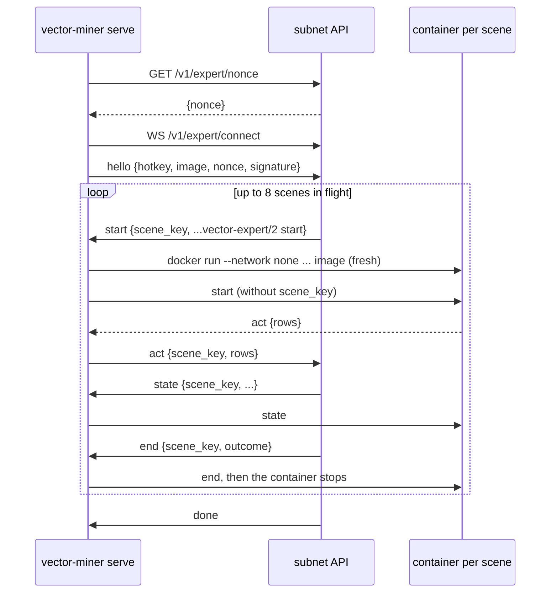
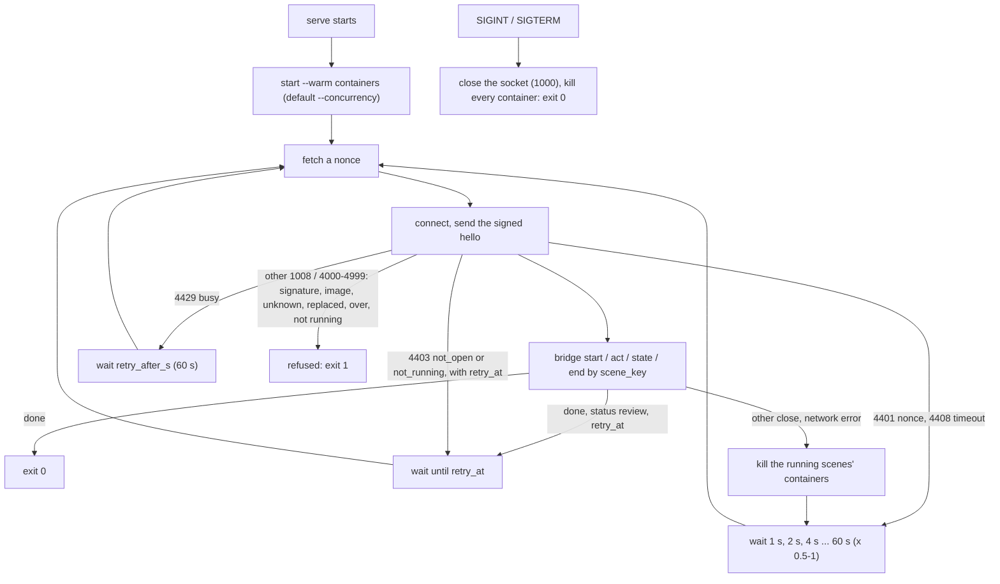

# bin-picking-expert

The miner guide of the competition `bin-picking-expert`. You write an expert: a program that picks the target part
out of a bin, step by step, over the `vector-expert/2` protocol ([vector-env](https://github.com/robotensor/vector-env/blob/main/skills/bin-picking/README.md#vector-expert2)). You commit one image, once per
hotkey; phase 1 starts as soon as your miner connects, and the rest of the evaluation runs after the end of the round
in which phase 1 ended. Setup, the wallet and the `vector-miner` command are in the repository's
[README](../../../README.md). Every command below runs from the vector-miner folder.

```mermaid
flowchart LR
  A["write your expert (skills/bin-picking/expert/example/)"] --> B["vector-miner eval: local score"]
  B --> DT["vector-miner eval --determinism N"]
  DT --> C["docker build, push to ghcr.io (public, or private and shared with the team account)"]
  C --> E["image@sha256 digest"]
  R["btcli subnet register: hotkey gets a uid"] --> F
  E --> F["vector-miner fee pay, then vector-miner commit (once per hotkey, ever)"]
  F --> SV["vector-miner serve: your machine plays your fresh scenes, 1,000 by default (phase 1)"]
  SV --> SC["phase-1 score"]
  SC -->|"not above the bar (the king's score + margin)"| BK["below_king (final)"]
  SC -->|"above"| RE["the subnet copies your image into its private registry, and the submission waits for the end of its round (the round its phase 1 ended in)"]
  RE --> Q["the round's evaluation: highest phase-1 score first, one at a time"]
  Q --> CP["the subnet copies your image into its private registry, if that has not happened yet"]
  CP -->|"the image is gone (deleted, or private and not shared)"| DQ["disqualified"]
  CP --> P2["phase 2: the copy runs in docker on 100 of the scenes (by default)"]
  P2 -->|"an action hash differs, or a scene is over the wall"| DQ
  P2 -->|"all equal"| PS["passed: waits for the round decision"]
  PS --> RD{"round decision: the round's best three above the bar"}
  RD -->|"in"| RK["ranked: rank 1 (the king) 70 %, rank 2 20 %, rank 3 10 % of bin-picking-expert's emission"]
  RD -->|"out"| NR["not_ranked"]
  RK --> KP["rank 1: its image is published at ghcr.io/robotensor/vector-king"]
  RK --> V["vector-miner verify --submission ID"]
  NR --> V
  DQ --> V
  BK --> V
```



## Rounds

bin-picking-expert runs in rounds of its own. Their length is a setting of this competition; the rounds are shown
with their dates in `GET /v1/skills/bin-picking/expert`: the current one as `round`, the next one as `next`, both in
its `leaf` object.
What you run for a round is the tag `bin-picking-expert-r<n>` of vector-miner, vector-env and vector-sim; round 1 is
`bin-picking-expert-r1`:

```bash
for repo in vector-miner vector-env vector-sim; do
  git clone --branch bin-picking-expert-r1 https://github.com/robotensor/$repo
done
cd vector-miner && scripts/setup.sh
```

The competition's state is `leaf.status` of `GET /v1/skills/bin-picking/expert` (`vector-miner status` shows it):

| `leaf.status` | what happens |
|---|---|
| `planned` | round 1 has not started: no phase 1 is played. A commit made now is picked up when round 1 starts |
| `ongoing` | a round is running: commits are picked up and phase 1 is played |
| `paused` | the last round has ended and no next round is running yet: no phase 1 is played. A commit made now is picked up when the next round starts |
| `finished` | the last round has ended: the competition takes no commits |
| `archived` | the competition is closed: it takes no commits, and its API paths answer 404 |

While the competition is not `ongoing`, `serve` waits for the next round when its start is known and stops (exit 1)
otherwise. Phase 2 and the decision of an ended round still run.

## Salt, scenes and phase 1

On commit the subnet makes a secret salt for your submission and publishes its `salt_sha256`; your scenes are drawn
from that salt. The evaluation sizes, 1,000 phase-1 scenes and 100 phase-2 scenes, are settings of this competition and
can change at any time: each submission is evaluated on the sizes in force when it was committed, whatever changes later, and
the board shows them per submission (`eval: {scenes, phase2_scenes}` on each row of
`GET /v1/skills/bin-picking/expert/submissions`; `phase1.total` is its scene count). Phase 1 is played on your
machine: `vector-miner serve` dials out to the subnet, our simulator plays every scene against your image step by
step, and each scene's rows are hashed (the action hash).

Your submission belongs to the round in which its phase 1 ends. Phase 1 alone ranks the scripts: the bar is the
king's phase-1 score + `margin` (0), so a score must be higher than the king's, and before the first round decision
there is no king and no bar. Any score must be above the minimum score (0: at least one scene solved) to rank. A
phase-1 score not above the bar is `below_king` at once; the others wait until their round ends, and then that
round's evaluation runs while the next round already runs: by phase-1 score, highest first (an older round before a
later one), one submission at a time, each checked against the bar again when its turn comes. The subnet keeps your
phase-1 scenes and results for this.

## Phase 2

As soon as your phase 1 is scored above the bar, the subnet copies your committed image into its own private registry
(until then keep the image public, or private and shared with the subnet's team account with Read access; a copy
that could not be made is tried again when your submission's turn comes, and an image the subnet cannot pull then is
`disqualified`, "image no longer available"); everything after that runs the copy. Phase 2 re-runs it on our side
(docker, `--network none`) on 100 of those scenes (its `phase2_scenes`): every action hash must equal phase 1's, or
the submission is disqualified. A submission that passes phase 2 is `passed`. There is no king run and no re-check
against the king.

## Ranks and pay

When every submission of the round is final or `passed`, the round is decided. The ranks are a window of at most
three submissions, rank 1 (the king) first. The ranks of the latest decided round are paid 70 %, 20 % and 10 % of
bin-picking-expert's emission (`rank_shares` in `GET /v1/skills/bin-picking/expert`) until a newer round is decided;
an empty rank's share is burned, and so is the share of a rank whose hotkey has no uid. The round's `passed`
submissions above the bar enter, best phase-1 score first (ties: the earlier commit block), at most three: the best
new one becomes the king and each new one pushes the lowest old rank out. They are `ranked`; the round's other
`passed` submissions are `not_ranked`. A ranked submission pushed out later keeps `ranked` with `ranked_out_round`.
Example: ranks 0.10, 0.50, 0.70 (rank 3, 2, 1) and a round bringing 0.70, 0.72 and 0.74: 0.70 is not higher than the
king, so 0.72 and 0.74 enter and the ranks become 0.70 (rank 3), 0.72 (rank 2), 0.74 (rank 1, the new king).

## The king image

The subnet's copies of submitted images are private: nobody outside the subnet's team can pull them. Only the king
is public: once a round's evaluation is over and its decision is final, the king's image (rank 1, paid until a newer
round is decided) is published at `ghcr.io/robotensor/vector-king`, which holds that one image, tagged `king` and
`round-<n>`. `GET /v1/skills/bin-picking/expert` gives its digest reference as `king.public_image` (null until it is
published). Pull it to inspect the king, run it, compare with it or build your own image on top of it; committing it
as it is, or its layers under another digest, is a `copy` and is refused.

```bash
docker pull ghcr.io/robotensor/vector-king:king
.venv/bin/vector-miner eval --image ghcr.io/robotensor/vector-king:king --pull --scenes 1000 --seed 7
```

## From an expert to a submission

```bash
# 1. evaluate locally (a command while developing, then the image)
.venv/bin/vector-miner eval --command "node skills/bin-picking/expert/example/solve.mjs" --scenes 20 --seed 1
(cd skills/bin-picking/expert/example && docker build -t ghcr.io/<you>/bin-expert:dev .)
.venv/bin/vector-miner eval --image ghcr.io/<you>/bin-expert:dev --scenes 100 --seed 7 --workers 4

# 2. check it is deterministic (phase 2 disqualifies an image that is not)
.venv/bin/vector-miner eval --image ghcr.io/<you>/bin-expert:dev --determinism 20 --seed 7 --workers 4

# 3. push to ghcr.io (a GitHub token with write:packages)
echo <github-token> | docker login ghcr.io -u <github-user> --password-stdin
docker push ghcr.io/<you>/bin-expert:dev

# 4. on GitHub: the package's settings -> change visibility -> public, or keep it private and
#    Manage access -> add the team account (`pull_account` in GET <api>/v1/skills/bin-picking/expert), role Read

# 5. the digest
docker inspect --format '{{index .RepoDigests 0}}' ghcr.io/<you>/bin-expert:dev    # ghcr.io/<you>/bin-expert@sha256:<digest>

# 6. a wallet, and its hotkey registered on the subnet (once; read "Wallet and registration" first)
.venv/bin/btcli wallet new-coldkey --wallet <coldkey>
.venv/bin/btcli wallet new-hotkey --wallet <coldkey> --wallet-hotkey <hotkey>
.venv/bin/btcli subnet burn-cost <netuid>
.venv/bin/btcli subnet register --netuid <netuid> --wallet <coldkey> --wallet-hotkey <hotkey>

# 7. optional: a trial commit on testnet (test TAO, never evaluated on mainnet)
.venv/bin/btcli subnet register --network test --netuid <test-netuid> --wallet <coldkey> --wallet-hotkey <hotkey>
.venv/bin/vector-miner commit --network test --netuid <test-netuid> --no-api-check \
  --image ghcr.io/<you>/bin-expert@sha256:<digest> --wallet.name <coldkey> --wallet.hotkey <hotkey>

# 8. pay the submission fee from the coldkey that owns the hotkey, then wait until fee status lists it
export VECTOR_MINER_API=https://vector.robotensor.ai
.venv/bin/vector-miner fee pay --wallet.name <coldkey> --wallet.hotkey <hotkey>
.venv/bin/vector-miner fee status --wallet.name <coldkey> --wallet.hotkey <hotkey>

# 8b. commit, once: this hotkey can never commit another image
.venv/bin/vector-miner commit --image ghcr.io/<you>/bin-expert@sha256:<digest> --netuid <netuid> \
  --wallet.name <coldkey> --wallet.hotkey <hotkey>

# 9. serve it: phase 1 runs while this runs (start it within 48 h of the commit)
docker pull ghcr.io/<you>/bin-expert@sha256:<digest>
.venv/bin/vector-miner serve --image ghcr.io/<you>/bin-expert@sha256:<digest> \
  --wallet.name <coldkey> --wallet.hotkey <hotkey>

# 10. follow it
.venv/bin/vector-miner status --wallet.name <coldkey> --wallet.hotkey <hotkey>
```

`<netuid>` and `<test-netuid>` are published with the subnet.

### The submission fee

- Every submission must be backed by its own payment of this competition's submission fee (now 0.1 TAO) to its vault
  (now `5DSaD8eKWjRqSxKspk9CQRbhzHVidxKEdoXBzBTf5WMd8668`). The amount and the vault are also shown on the Bin
  picking page and in `fee` of `GET /v1/skills/bin-picking/expert` (and in its `leaf.fee`), and can change.
- The payment is a transfer of at least the fee from the coldkey that owns the committing hotkey to the vault, made
  at or before the commit's block. Pay before you commit.
- One payment backs one submission. A commitment without one is `unpaid` and is never evaluated; it does not use the
  hotkey's submission: pay, then commit again.
- `vector-miner fee pay` reads the fee and the vault from the API, asks, then sends the transfer signed by the
  wallet's coldkey (`--yes` skips the question, `--again` pays when an unused payment exists, `--network` finney).
  `vector-miner fee status` shows the fee, the vault, the owner coldkey and its unused payments.
- `vector-miner commit` refuses without an unused payment and prints what to pay (`--no-api-check` skips it).

### Wallet and registration

The wallet, the registration and the testnet trial are in the repository's [README](../../../README.md#wallet-and-registration).
For this competition:

- The hotkey signs your commit and every `serve` connection. It commits once: one submission per hotkey, ever.
- Only the three ranks earn, so a hotkey without a rank can lose its uid and must register (and pay) again; a rank
  whose hotkey lost its uid has its share burned. Check before the commit that the hotkey has a uid
  (`.venv/bin/btcli wallet overview --netuid <netuid> --wallet <coldkey>`).

## Determinism

The same scene and the same messages must give the same rows, every run, on any machine. Phase 2 checks this on
a sample of your scenes (100 by default) by comparing action hashes ([vector-env's bin-picking README](https://github.com/robotensor/vector-env/blob/main/skills/bin-picking/README.md#vector-expert2) defines the
hash: FNV-1a 64 over every row value you sent); one difference disqualifies the submission.

- Seed every random draw from the scene (`scene.scene_id`, `checkpoint`), never from the time, the process id or
  `/dev/urandom`. Python: `random.Random(scene_id)`, numpy: `np.random.default_rng(seed)`; JavaScript has no
  seeded `Math.random`: use a small seeded generator.
- Read no clock to decide anything: no time budgets ("plan until 1.5 s have passed"), no timeouts that change the
  plan. The simulator is paused while it waits for you; phase 2 runs on other hardware than yours.
- No threads or processes racing on a result: a parallel search must merge its results in a fixed order, and
  `--cpus` must not change the answer (phase 2 runs with `--cpus 4 --memory 8g`).
- Floating point: the same image gives the same floats; avoid reductions whose order depends on thread timing
  (multi-threaded BLAS, GPU kernels).
- `vector-miner eval --determinism N` runs N scenes, then runs them again in reverse order, and compares every
  action hash with vector-env's `harness.compare`. Exit 0 = all equal; 1 = a scene sent other rows (listed);
  2 = it could not tell (a scene did not run both times). Run it on the image itself, with `--workers` as high as
  phase 1 will run it.

## Phase 1: serve





- `serve --image REF` takes the image you committed (`ghcr.io/<you>/<repo>@sha256:<digest>`) and runs it as the
  subnet does in phase 2: one fresh container per scene, started by vector-env's own docker command
  (`harness.docker_argv`): `--network none`, read-only root filesystem, `/tmp` in memory, user 65534, no
  capabilities, 256 processes, `--cpus 4 --memory 8g`, the asset bundle at `/bundle` (`VECTOR_SIM_BUNDLE`). The
  image must be local (`--pull` pulls it). `--command "..."` runs a local program per scene instead (development,
  tests); the hello still names `--image`.
- The hello is signed by the wallet's hotkey: sr25519 over `vector-connect\n<image>\n<nonce>`, with a nonce fetched
  fresh for every connection. The subnet only plays scenes for the hotkey and image of a commit.
- Your expert sees exactly the `vector-expert/2` lines of a local `eval` (the `scene_key` is removed); what it
  writes goes back with its `scene_key`. A line that is not a JSON object, a line over 1 MiB, or an exit before the
  scene's `end` is sent to the subnet as `{"type":"error"}` for that scene.
- Deadlines (the simulator is paused while it waits for you):

  | wait | limit | welcome field |
  |---|---|---|
  | the first `act`, after `start` | 10 s | `first_step_deadline_s` |
  | every later `act`, after a `state` | 2 s | `step_deadline_s` |
  | the whole scene | 45 s | `wall_s` |

  A late act ends the scene as `step_timeout`, a scene over its wall time as `wall_timeout`; both, and a dropped
  connection, are your failures, and phase 2 leaves those scenes out of its sample. `vector-miner eval` holds your
  expert to the same deadlines. Containers are started ahead (`--warm N`, default `--concurrency`) so a scene does
  not wait for `docker run`; `--concurrency N` (default 8, what the subnet sends at once) is the most scenes `serve`
  runs at once: a `start` past it is answered with an error (that scene is your `expert_error`) and the welcome's
  `concurrency` above yours is logged as a warning, so keep it at 8. A `start` for a restart of a scene
  (`<index>.<n>`) replaces the older one. Messages from the subnet are at most 4 MiB.
- The subnet checks every act: a message is at most 64 KiB (300 rows of 7 numbers fit), at most 200 messages a second
  are read per socket (faster ones wait), and a row must be 7 finite numbers within ±100. `NaN`, `Infinity`, a string,
  `true` or a larger value ends that scene as `expert_error`, your failure.
- When the connection drops, the running scenes' containers are killed and `serve` reconnects with backoff
  (1 s doubling to 60 s, times 0.5 to 1); the subnet restarts the unfinished scenes from tick 0, at most twice per
  scene. Keep `serve` running until it prints `done`, ideally under a process manager (systemd, tmux or pm2) so it
  starts again if it stops.
- Phase-1 slots: the subnet runs 2 submissions at once. A free slot goes to the earliest commit among the miners that
  tried to connect in the last 150 s; the others get `4429 busy`. A reconnect within 60 s keeps the same slot. A
  submission takes at most 3 slots, and the third waits behind every other miner; when it ends with phase 1
  unfinished, the scenes not played count as failed. A slot the subnet ended (a server restart) is not counted.
  `phase1.slots` in `vector-miner status` and the submissions list shows the slots used.
- `{"type":"welcome"}` (submission, status, `done`/`scenes`, the deadlines) and `{"type":"error"}` without a
  `scene_key` (its `reason` and `message`) are printed. `{"type":"done"}` (phase 1 finished: status, score,
  successes/scenes) ends `serve` with exit 0; when its status is `review` with a `retry_at` (scenes failed on the
  subnet's side), `serve` waits until then and connects again.
- A refusal is a `{"type":"error", reason, message}` and a close whose reason is `<reason>: <message>`. Not final,
  `serve` connects again: `4429 busy` after `retry_after_s` (default 60 s); `4403 not_open` with a `retry_at`
  (phase 1 in review) and `4403 not_running` with a `retry_at` (the competition is not `ongoing`; `retry_at` is the
  start of its next round) at that time; `4408 timeout` and `4401` for an unknown or expired nonce with the usual
  backoff (a nonce refusal at most 5 times in a row). Final, exit 1 with the reason: a bad signature or hello
  (`4401`), not the committed image (`4403 image`), no submission for the hotkey (`4404`), phase 1 over
  (`4403 not_open` without `retry_at`), the competition not `ongoing` with no next round (`4403 not_running` without
  `retry_at`), a newer connection of the same submission (`4409 replaced`), a message too big (`4413`), and any
  other 1008 or 4000-4999 close.
- Ctrl-C or SIGTERM closes the socket (code 1000) and kills every container: exit 0. `--stderr DIR` keeps each
  container's stderr in `DIR/<container name>.log`; the log names the scene of each container.

## Status

```bash
.venv/bin/vector-miner status --api https://vector.robotensor.ai --wallet.name <coldkey> --wallet.hotkey <hotkey>
```

One JSON object: `leaf` (the competition: `{id, status, round, next}` from the board's `leaf`, null when the API
does not give one), `king` (whether you are the king, rank 1), `rank` (your hotkey's rank now, or null),
`king_hotkey`, `king_image` (the king's public image, `king.public_image`; null until it is published), `king_score`
(its phase-1 score), `bar` (the king's score + margin; null before the first round decision, when `ranks_note` says
so), `margin`, `ranks` (`[{rank, share, hotkey, score, round}]`, rank 1 first), and `submissions`, each with `id`,
`image`, `status`, `committed_at`, `salt_sha256`, `phase1 {done, total, score, successes}`, `round` (the round its
phase 1 ended in), `evaluates_at` (when that round ends, while it is ahead), `queue_position` (evaluation order: older
round first, then highest phase-1 score first), `phase2`, `stage`, `rank` (its place in the ranks now), `rank_at`
(the rank it entered with), `ranked_out_round`, `reason`, `retry_at`, `final` and `verdict` (one line, also printed to
stderr). When `leaf.status` is not `ongoing`, stderr also gets `vector-miner: bin-picking-expert is <status>: it
plays no phase 1 now`, with `; its next round starts at <next.starts_at>` when the next round is known.
It reads `GET /v1/skills/bin-picking/expert` and `GET /v1/skills/bin-picking/expert/submissions?hotkey=<ss58>`.

| status | meaning |
|---|---|
| `waiting_connection` | committed; run `serve` (abandoned after 48 h without any connection attempt; a refusal because every slot is busy counts as an attempt) |
| `phase1` | `serve` is playing your scenes: `phase1.done` of `phase1.total`. After the first hour on the socket it must keep up 200 scenes an hour on average (8 at once do ≥ 640), or the rest count as failures and the slot goes to the next miner |
| `scored` | phase 1 is done and above the bar: waits for its round to end (`evaluates_at`), then for its turn in the evaluation (`queue_position`) |
| `below_king` | phase 1 is not above the bar (the king's score + margin); final. A queued submission is checked against the bar again when its turn comes (the bar only rises) |
| `phase2` | `stage` `copy`: we copy your image into our private registry, if that has not happened yet; then we run the copy in docker on 100 (by default) of your scenes and compare action hashes |
| `passed` | phase 2 passed; decided when its round is (every submission of the round final or `passed`) |
| `ranked` | in the ranks after its round's decision: "rank k · 70% of bin-picking-expert's emission" (20%, 10%) while it holds one, "ranked out in round m" after; final |
| `not_ranked` | phase 2 passed but not in the ranks: not above the bar, or not in its round's top three; final |
| `disqualified` | phase 2 found another action hash or a scene over the wall, the image was gone when we copied it, or a stage failed on our side again after 2 reviews (`reason`); final |
| `duplicate_hotkey` | a second commit from a hotkey that already had one; never evaluated |
| `invalid` / `copy` | a bad commit, the digest of an earlier submission; neither uses the hotkey's submission, so it may commit again |
| `abandoned` | no connection attempt within 48 h; final, and it does not use the hotkey's submission: the hotkey may commit again |
| `review` | more than 2 % of a stage's scenes failed on the subnet's side; that stage runs again at `retry_at` (6 h later). Not your expert's fault; in phase 1 keep `serve` running |

## Commands

```bash
vector-miner eval (--command "..." | --image REF) [--scenes 20 | --determinism N] [--seed 0] [--workers 1]
                  [--time-limit 15] [--wall 45] [--cpus 4] [--memory 8g] [--docker docker] [--pull] [--results FILE]
                  [--stderr DIR] [--trace DIR] [--scene-cache DIR | --no-scene-cache]
                  [--first-step-deadline 10] [--step-deadline 2] [--strict]
vector-miner commit --image REF --netuid <netuid> [--network finney] [--api URL | --no-api-check]
                    [--wallet.name --wallet.hotkey --wallet.path] [--no-check]
vector-miner serve --image REF [--api URL] [--concurrency 8] [--warm N] [--command "..."] [--cpus 4] [--memory 8g]
                   [--docker docker] [--pull] [--stderr DIR] [--wallet.name --wallet.hotkey --wallet.path]
vector-miner status --api URL [--hotkey <ss58>] [--wallet.name --wallet.hotkey --wallet.path]
vector-miner fee status [--api URL] [--hotkey <ss58>] [--wallet.name --wallet.hotkey --wallet.path]
vector-miner fee pay [--api URL] [--network finney] [--yes] [--again] [--wallet.name --wallet.hotkey --wallet.path]
vector-miner verify --submission ID (--api URL | --doc FILE) [--save FILE] [--hash-scenes M]
                    [--image REF|submission [--command "..."] [--scenes 20] [--sample-seed 0] [--workers 1]
                    [--wall S] [--cpus 4] [--memory 8g] [--docker docker] [--pull]] [--salt-sha256 HEX]
                    [--allow-uncommitted]
```

`vector-miner --leaf bin-picking-expert <command>` is the same command. `$VECTOR_MINER_API` can hold the API address
(`--api`).

- `eval` generates random scenes from `--seed` and plays them the way phase 1 does: vector-env's remote harness
  sends the messages through `serve`'s bridge (in-process, no network) to a fresh expert per scene, started ahead
  like `serve --warm`, and holds every act to the phase-1 deadlines: 10 s for the first act after `start`
  (`--first-step-deadline`), 2 s for each later one (`--step-deadline`). A late act ends the scene `step_timeout`,
  as in phase 1. The summary gains `deadlines` (`first_act_max_s`, `first_act_mean_s`, `later_act_max_s`, measured
  at the bridge; `late_scenes`, `step_timeouts`), a warning lists late acts, and `--strict` makes them exit 1.
  `--workers N` scenes run at once on this machine, which also runs the simulator: phase 1 runs 8 and the
  simulator is on the subnet's side, so measure with `--workers 8` on the machine that will `serve`.
  `--command` runs a local program (no docker, no sandbox). `--image` starts a fresh container per scene as
  phase 2 does: `--network none`, read-only root filesystem, `/tmp` in memory (1 GB), user 65534 with `HOME=/tmp`,
  no capabilities, 256 processes, 1024 open files, `--cpus 4 --memory 8g`, 15 s of robot time and 45 s of wall
  time per scene. The image must already be local (`--pull` pulls it first). `--results` writes one JSON line per
  scene (both runs with `--determinism`); `--stderr DIR` writes your expert's stderr of every scene to
  `DIR/<index, 4 digits>-<scene_id>.log` (e.g. `0000-s121011998878783-4a5b69a2.log`); `--trace DIR` writes a
  per-tick trace of every scene (below). Change the limits only to experiment: the subnet uses the defaults.
  Without an asset bundle (see the repository's README) `eval` prints the reason and exits 2.
- Generating a scene takes about 2 s. `--workers N` generates (and runs) N scenes at a time, and generated scenes
  are kept in `~/.cache/vector-env/scenes` (per vector-env version, asset sha256, draw, seed and index), so the
  next `eval` with the same `--seed` reuses them: compare variants of your expert on the same seed.
  `--scene-cache DIR` (or `VECTOR_ENV_SCENE_CACHE`) moves the cache, `--no-scene-cache` turns it off.
- `commit` applies the subnet's checks before it sends anything: the reference is
  `<registry>/<repo>@sha256:<64 hex>` (lower case, no tag), at most 128 characters, and the registry is `ghcr.io`.
  It then asks the registry anonymously for that digest: an unknown digest or a registry that answers another digest
  is refused (`--no-check` skips this). A private image (anonymous pulls refused) that your own docker login can
  read (`docker manifest inspect`) is committed with a warning: the subnet pulls images as its team account
  (`pull_account` of `GET /v1/skills/bin-picking/expert`, named in the warning), so share the package with that
  account (ghcr.io: Package settings -> Manage access -> add it, role Read) before you commit, or the commit is
  `invalid`. The reference is committed without surrounding spaces.
- One submission per hotkey, ever. `commit` asks the public API
  (`GET /v1/skills/bin-picking/expert/submissions?hotkey=<ss58>`) first and refuses when the hotkey's submission is
  used: any earlier commit except an `invalid`, `copy`, `duplicate_hotkey` or `abandoned` one, which the subnet does
  not count. The subnet would record a second commit as `duplicate_hotkey` and never evaluate it. To submit another
  image, register another hotkey. When the API cannot be reached `commit` stops; `--no-api-check` skips the check
  (the testnet trial). The same digest, or the same image layers under another digest, as an earlier submission of
  another hotkey is a `copy`.
- `commit` also reads `leaf.status` from the API, before the other API checks: a `finished` or `archived`
  competition is refused before anything is sent (`vector-miner: bin-picking-expert is finished: it takes no
  commits`); while it is `planned` or `paused` it warns `the commit is picked up when its next round starts` and
  commits. `--no-api-check` skips this check too.
- After a commit, `commit` prints the `serve` and `status` commands to run next (with the `--api` and `--wallet.*`
  flags you gave); phase 1 waits for `serve` at most 48 h.

### Inspect a failure

```bash
.venv/bin/vector-miner eval --command "node skills/bin-picking/expert/example/solve.mjs" --scenes 30 --seed 1 \
  --workers 4 --results r.jsonl --trace traces --stderr logs
#   why s27260578352828-f7734b96: timed_out at tick 300 (15 s): 15 s | ... | the target was held for 18 ticks
#   (ticks 52-69); it was not held from tick 70 | its lowest point got to 202.3 mm below the lift line ...
.venv/bin/vector-env scene --seed 27260578352828 > scene.json
.venv/bin/vector-env replay --scene scene.json --result r.jsonl --trace one.json
```

Each failed scene gets a `why` line. `traces/<index>-<scene_id>.json` holds, per tick, the row stepped, the joints,
the grip, the tcp pose, the parts held and touched and the target's height against the lift line, plus `reasons`
and a `summary`; [vector-env's bin-picking README](https://github.com/robotensor/vector-env/blob/main/skills/bin-picking/README.md#inspect-a-failure) lists every field. The scene's seed is the number after `s` in its id.

## Verify a submission

Once a submission is final (`below_king`, `ranked`, `not_ranked` or `disqualified`; `passed` waits for its round's
decision), the API publishes everything needed to check it at
`GET /v1/skills/bin-picking/expert/submissions/<id>/verify` (404 until then): the salt and its commitment, the
vector-env version and asset sha256 the scenes were made with, every scene's seed and state hash, phase 1 (score and
per-scene success, time, outcome, action hash), phase 2 (the scenes, their action hashes and wall times) and the
decision `{round, bar, rank_at, new}` (the bar, the rank it entered with, the submission ids that entered at its
round's decision); `submission.mirror_url` names the subnet's private copy of the image, which only the team can
pull. Checking the document and regenerating the scenes needs no image. There is no king run to check.


```bash
# check the document and regenerate all its scenes (1000 by default, about 2 s each; --hash-scenes 100 checks a sample)
.venv/bin/vector-miner verify --submission <id> --api https://vector.robotensor.ai

# the king: also re-run its public image on 20 sampled scenes in docker and compare action hashes
.venv/bin/vector-miner verify --image king --api https://vector.robotensor.ai --hash-scenes 100 --scenes 20 --pull

# re-run the image a submission committed (you can pull it if it is public or yours)
.venv/bin/vector-miner verify --submission <id> --api https://vector.robotensor.ai --image submission --scenes 20 --pull

# with the salt commitment you noted at commit time
.venv/bin/vector-miner verify --submission <id> --api https://vector.robotensor.ai --salt-sha256 <64 hex>
```

- Seeds: scene `i` uses `int.from_bytes(sha256(f"{salt}:0:{i}").digest()[:6], "big")`, vector-env's
  `scenes.seed_for(0, i, salt)`, plus `k`: the first `k` below `seed_tries` (6) whose draw places a scene
  (`scenes.draw_scene`). An index none of whose draws places a scene is listed in `skipped`; a full check also
  confirms every skipped index fails here.
- The salt: `salt_sha256` must be the sha256 of the published salt, committed (`salt_committed_at`) no later than
  `phase1_started_at`, and equal to `--salt-sha256` when given, else to the submission view's `salt_sha256`
  (`GET /v1/skills/bin-picking/expert/submissions/<id>`) when the document comes from `--api`. A null
  `salt_committed_at` (or `phase1_started_at`) is a document problem (exit 1); `--allow-uncommitted` lists it under
  `document.warnings` instead and checks the rest.
- The document check: the seeds derive from the salt, `scenes_sha256` is
  `sha256("\n".join(f"{index}:{seed}:{state_hash}"))`, the phase-1 score is successes / scenes with a verdict
  (infrastructure failures, an `INFRA_OUTCOMES` outcome or none, are left out; `not_run` and timeouts count as
  failures), mean times match the successful scenes; `below_king` needs a phase-1 score not above
  `decision.bar` (a null bar: no king, any score above the minimum counts) and no phase 2; any other final status
  needs one above it and a phase 2 on the sample rule's scenes: the `phase2_scenes` (the submission's own, 100 by
  default) indexes with the smallest `sha256(f"{salt}:phase2:{index}")`, sorted, among the phase-1 scenes with an
  action hash and an outcome not in `excluded_outcomes` (the infrastructure outcomes, `not_run` and the cut-offs
  `step_timeout`, `disconnected`, `wall_timeout`; a document that leaves out any other outcome is a problem; one
  without the field is read with the older rule, only infrastructure failures and `not_run` left out). Each phase-2
  scene has an outcome, an action hash and a wall time; phase-2 infrastructure failures are left out of the
  comparison, and it passes when at least one scene is compared, every hash equals phase 1's and no scene is a
  `wall_timeout` or over `wall_s`; `disqualified` needs a phase 2 that did not pass and a reason, or a reason
  that starts with `image no longer available` / `repeated failures on our side` (then nothing after phase 1 is
  needed); `ranked` and `not_ranked` need phase 2 passed. The decision: `decision.round` is the submission's
  `round`; `ranked` needs its id in `decision.new` (at most three, no repeats) and a `rank_at` within the entered
  ones (the new ones take ranks 1 to n); every other status has no `rank_at` and is not in `new`; a `not_ranked`
  score above the bar needs three others to have entered (`new` full). The other submissions' scores are not in the
  document, so the order within `new` is not recomputed.
  Images must be `ghcr.io/<repo>@sha256:<digest>` with their own `digest`.
- `--image` takes `king`: the king's public image (`king.public_image`, read from `--api`), on the king's submission
  (the default `--submission`; another submission is refused, and so is a king without a public image yet); or
  `submission`, or the submission image's reference, digest or hotkey: the image the submission committed. It runs
  that image (or `--command` instead) on `--scenes` scenes with a published verdict that is not a cut-off, sampled
  with `--sample-seed`, and reports `hash_equal`, `hash_agreement`, `outcome_agreement` and every scene whose action
  hash differs. A deterministic image gives the published hashes on any machine. Re-run differences do not change
  the exit code.
- `phase2` in the output repeats the phase-2 comparison: `compared`, `equal`, `mismatched`, `over_wall`, `infra`,
  `passed`; `decision` the round decision: `round`, `bar`, `rank_at`, `new` (how many entered), `entered`,
  `above_bar` (null for an older document without `decision.bar`).
- The document is read as strict JSON (no NaN), at most 64 MB, and every field is type-checked first.
- Regeneration needs the same vector-env version and asset bundle as the submission (`env` in the document, or a
  scene's own `env` when it was made with another one); with another one, the output warns, and a scene whose
  hash differs is listed under `unverified` (not as a mismatch). When the generator fails on every scene, including
  a known published one (no node, a missing or broken asset bundle), the check stops with exit 2.
- `--save FILE` keeps the document; `--doc FILE` checks a saved one offline. The output is one JSON object.
  Exit codes: 0 = the document adds up and every regenerated scene matches; 1 = a document problem (no salt
  commitment time included, unless `--allow-uncommitted`) or a scene mismatch (listed in the output); 2 = cannot
  check: a bad argument (no `--submission`, `--command` without `--image`, no `--api` without `--doc`, a `--doc`
  that is unreadable or of another submission, `--workers` below 1, a malformed `--salt-sha256`), a malformed,
  non-JSON or oversized document, the submission is not final (404) or the API failed, an `--image` that is not
  the submission's, vector-env is missing or its generator does not work here, the pull failed or the re-run
  could not run (docker missing, every scene an infra outcome), or scenes are `unverified` (the output is printed).
  Re-run differences are reported under `rerun` and do not change the exit code.

## The example and the base image

[example/](example/README.md) is an almost blind expert packaged as an image; [base/](base/README.md) is a
starting image with `@vector/sim` installed. The example image (`skills/bin-picking/expert/example/Dockerfile`)
runs as user 65534 with `HOME=/tmp` and writes nothing outside `/tmp`. Files your image reads must be readable by
that user.

## Tests

```bash
.venv/bin/python -m pytest skills/bin-picking/expert/tests
```

The `serve` tests run a fake subnet (a `websockets` server with the nonce endpoint) and
`skills/bin-picking/expert/tests/fake_expert.py`; with an asset bundle they also play real scenes through vector-env's
remote harness and compare the action hashes with a local run. No test talks to a chain.
