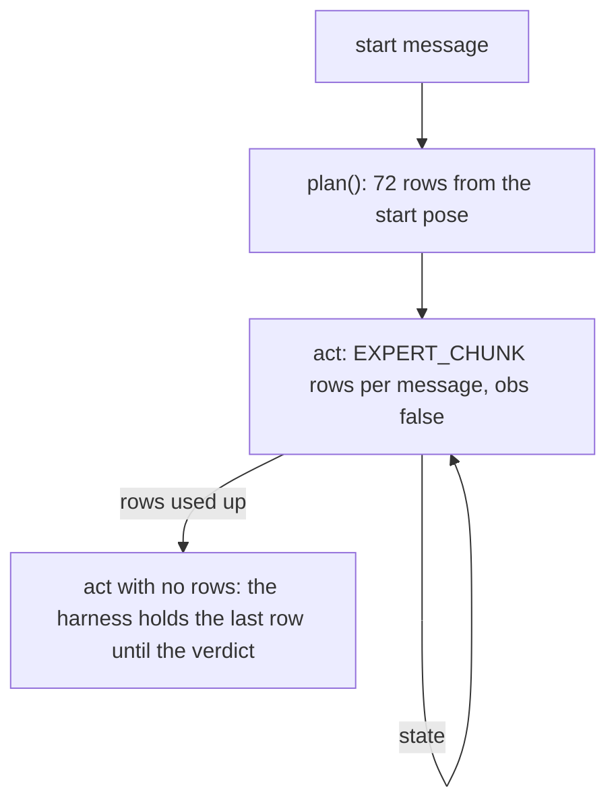

# Example expert

An almost blind `vector-expert/2` and `/3` expert: the message loop with the harness, packaged as an image. It reads only the
arm's start pose, lowers the arm a little, closes the gripper and goes back up, the same motion for every scene. It
never looks at the parts or the target, so most scenes end without a pick (score about 0). Copy it and write your
own `plan()`.



## What `solve.mjs` does

1. **Start.** On `start` it reads the arm's joints from `start.qpos` (`start.scene.meta.robot.arm_joints_qpos`) and
   logs the scene, the target and the camera size to stderr.
2. **Rows** (one row is 6 joint targets in rad and the grip, 0 open to 1 closed; one row is one tick of 0.05 s):
   30 rows from the start pose to the start pose plus `DOWN`, 12 rows closing the gripper, 30 rows back. The rows
   are cut to `start.limits.max_rows`.
3. **Sending.** It answers `start` and every `state` with the next `EXPERT_CHUNK` rows (20) and `obs: false`. When
   the rows are used up it sends an `act` with no rows, and the harness holds the last row until the verdict.
   An exception is sent as `{"type": "error"}`; `end` stops the program.

The rows depend only on the messages, never on a clock, so the expert is deterministic. To plan a real pick, build
the cell from `start.scene` with `@vector/sim` (installed by `package.json`), solve the poses with its IK and check
a plan with `runPlan` before sending it: [vector-sim's bin-picking README, section API](https://github.com/robotensor/vector-sim/blob/main/js/skills/bin-picking/README.md#api)
describes every call. A closed-loop
expert asks for `obs: true` and replans from each `state`.

## Running it

From the vector-miner folder:

```bash
(cd skills/bin-picking/expert/example && npm ci)   # setup.sh does it: @vector/sim is the vector-sim beside vector-miner
.venv/bin/vector-miner eval --command "node skills/bin-picking/expert/example/solve.mjs" --scenes 30 --seed 1 --workers 4
```

`--command` runs the program on this machine (no docker, no sandbox limits). `--stderr DIR` keeps its stderr of
every scene (`DIR/<index, 4 digits>-<scene_id>.log`), `--trace DIR` a per-tick trace of every scene and a `why` line
for each failed one. Scenes are generated `--workers` at a time and cached, so a second run on the same `--seed`
starts at once.

## The image

```bash
(cd skills/bin-picking/expert/example && docker build -t ghcr.io/<you>/bin-expert:dev .)
.venv/bin/vector-miner eval --image ghcr.io/<you>/bin-expert:dev --scenes 30 --seed 1 --workers 4
```

The Dockerfile fetches vector-sim at `ARG VECTOR_SIM_REF=bin-picking-expert-r2`, the round tag: the `@vector/sim`
of `package-lock.json` and the simulator the harness runs in that round. Keep the default. For a later round, build
with `--build-arg VECTOR_SIM_REF=<round tag>` (a tag, a branch or a full commit sha) and update
`package-lock.json`. `VECTOR_SIM_GIT` sets the repository. This `ARG` line is the round's one pin:
`scripts/setup.sh` reads it and fetches vector-env and the local vector-sim (the one `--command` plans with) at the
same tag, and `../base/build.sh` builds the base image from it.

The image copies `package.json`, `package-lock.json` and every `*.mjs` of this folder and runs `node solve.mjs`.
When you rename the entry file, change `ENTRYPOINT`; other files (data, other folders) need their own `COPY`.
The harness mounts the bundle at `/bundle` (`VECTOR_SIM_BUNDLE`) and runs the image as user 65534 with no network.
